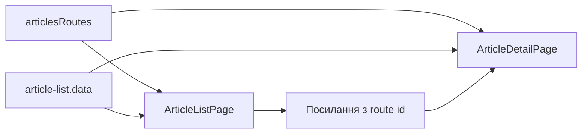

# Статті Storefront

**Вхід:** [articlesRoutes](../../../../libs/storefront/feature/articles/src/lib/lib.routes.ts) відкриває `/articles` і `/articles/:id`.

- [ArticleListPage](../../../../libs/storefront/feature/articles/src/lib/pages/article-list/article-list.page.ts) формує локалізований список із [article-list.data](../../../../libs/storefront/feature/articles/src/lib/pages/article-list/article-list.data.ts) і посилання на деталі.
- [ArticleDetailPage](../../../../libs/storefront/feature/articles/src/lib/pages/article-detail/article-detail.page.ts) відображає статтю за route id. Дані цієї фічі містяться у frontend, окремого article API у поточній реалізації немає.

## Схема будови



## Структура в коді

Фактичні точки входу й основні файли фічі (інші файли цих каталогів тут не перелічено):

```text
libs/storefront/feature/articles/
└── src/lib/
    ├── pages/
    │   ├── article-detail/article-detail.page.ts  # сторінка та композиція UI
    │   └── article-list/
    │       ├── article-list.data.ts  # сторінка та композиція UI
    │       └── article-list.page.ts  # сторінка та композиція UI
    └── lib.routes.ts  # маршрути фічі
```
