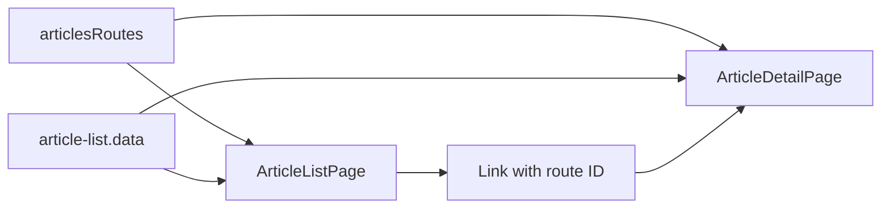

# Storefront Articles

**Entry point:** [articlesRoutes](../../../../libs/storefront/feature/articles/src/lib/lib.routes.ts) opens `/articles` and `/articles/:id`.

- [ArticleListPage](../../../../libs/storefront/feature/articles/src/lib/pages/article-list/article-list.page.ts) builds a localized list from [article-list.data](../../../../libs/storefront/feature/articles/src/lib/pages/article-list/article-list.data.ts) and links to details.
- [ArticleDetailPage](../../../../libs/storefront/feature/articles/src/lib/pages/article-detail/article-detail.page.ts) displays an article by route ID. This feature's data lives in the frontend; the current implementation has no separate article API.

## Architecture



## Code structure

Actual entry points and primary feature files (other files in these directories are omitted):

```text
libs/storefront/feature/articles/
└── src/lib/
    ├── pages/
    │   ├── article-detail/article-detail.page.ts  # page and UI composition
    │   └── article-list/
    │       ├── article-list.data.ts  # page and UI composition
    │       └── article-list.page.ts  # page and UI composition
    └── lib.routes.ts  # feature routes
```
