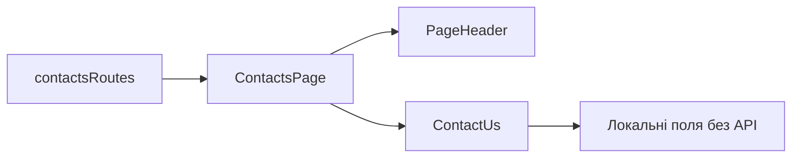

# Контакти Storefront

**Вхід:** [contactsRoutes](../../../../libs/storefront/feature/contacts/src/lib/lib.routes.ts) відкриває `/contacts`.

- [ContactsPage](../../../../libs/storefront/feature/contacts/src/lib/page/contacts-page/contacts-page.ts) складає локалізований заголовок і [ContactUs](../../../../libs/storefront/feature/contacts/src/lib/page/sections/contact-us/contact-us.ts); допоміжні секції належать цій самій feature-бібліотеці.
- Сторінка використовує спільний [PageHeader](../../../../libs/storefront/ui/src/index.ts). `ContactUs` має локальні поля форми, але в компоненті поки немає відправлення через API; не трактуй її як працюючий канал звернень.

## Схема будови



## Структура в коді

Фактичні точки входу й основні файли фічі (інші файли цих каталогів тут не перелічено):

```text
libs/storefront/feature/contacts/
└── src/lib/
    ├── page/
    │   ├── contacts-page/contacts-page.ts  # сторінка та композиція UI
    │   └── sections/contact-us/contact-us.ts  # сторінка та композиція UI
    └── lib.routes.ts  # маршрути фічі

libs/storefront/ui/
└── src/index.ts  # публічний API бібліотеки
```
