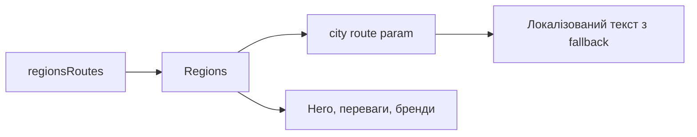

# Регіони Storefront

**Вхід:** [regionsRoutes](../../../../libs/storefront/feature/regions/src/lib/lib.routes.ts) відкриває `/region/:city`.

- [Regions](../../../../libs/storefront/feature/regions/src/lib/regions/regions.ts) читає `city` з route param, вибирає локалізований текст із fallback та складає hero, переваги компанії і бренди.
- [LocaleNavigationService](../../../../libs/storefront/util/src/lib/services/locale-navigation.service.ts) формує локалізовані посилання в інших частинах вітрини; окремого region API на цій сторінці немає.

## Схема будови



## Структура в коді

Фактичні точки входу й основні файли фічі (інші файли цих каталогів тут не перелічено):

```text
libs/storefront/feature/regions/
└── src/lib/
    ├── regions/regions.ts  # реалізація фічі
    └── lib.routes.ts  # маршрути фічі

libs/storefront/util/
└── src/lib/services/locale-navigation.service.ts  # сервіс фічі
```
