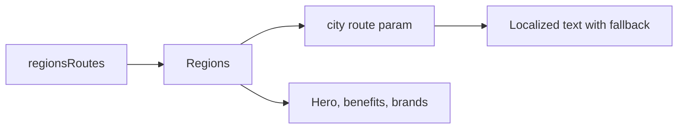

# Storefront Regions

**Entry point:** [regionsRoutes](../../../../libs/storefront/feature/regions/src/lib/lib.routes.ts) opens `/region/:city`.

- [Regions](../../../../libs/storefront/feature/regions/src/lib/regions/regions.ts) reads `city` from a route parameter, selects localized text with a fallback, and composes the hero, company benefits, and brands.
- [LocaleNavigationService](../../../../libs/storefront/util/src/lib/services/locale-navigation.service.ts) builds localized links elsewhere in the storefront; this page has no separate region API.

## Architecture



## Code structure

Actual entry points and primary feature files (other files in these directories are omitted):

```text
libs/storefront/feature/regions/
└── src/lib/
    ├── regions/regions.ts  # feature implementation
    └── lib.routes.ts  # feature routes

libs/storefront/util/
└── src/lib/services/locale-navigation.service.ts  # feature service
```
