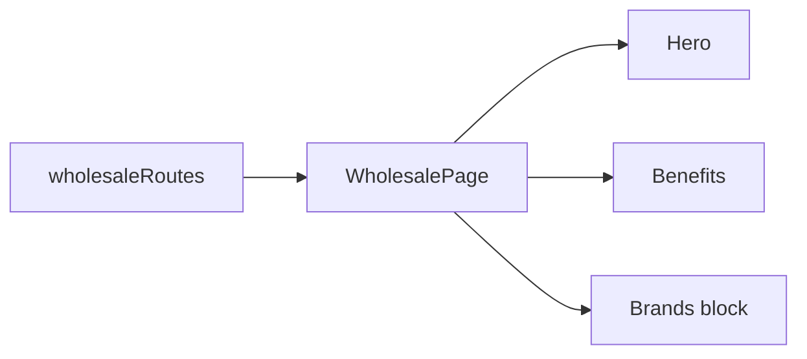

# Storefront Wholesale Customers

**Entry point:** [wholesaleRoutes](../../../../libs/storefront/feature/wholesale/src/lib/lib.routes.ts) opens `/wholesale`.

- [WholesalePage](../../../../libs/storefront/feature/wholesale/src/lib/wholesale/page/wholesale-page.ts) composes the hero, benefits, and shared brands block; its sections are alongside it in `feature/wholesale`.
- The page component has no order state or API of its own. Purchasing goes through the separate [catalog](../catalog/catalog.md), [cart](../catalog/cart.md), and [checkout](../catalog/checkout.md).

## Architecture



## Code structure

Actual entry points and primary feature files (other files in these directories are omitted):

```text
libs/storefront/feature/wholesale/
└── src/lib/
    ├── wholesale/page/wholesale-page.ts  # page and UI composition
    └── lib.routes.ts  # feature routes
```
