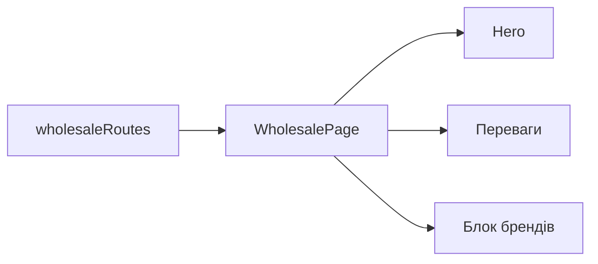

# Оптові покупці Storefront

**Вхід:** [wholesaleRoutes](../../../../libs/storefront/feature/wholesale/src/lib/lib.routes.ts) відкриває `/wholesale`.

- [WholesalePage](../../../../libs/storefront/feature/wholesale/src/lib/wholesale/page/wholesale-page.ts) складає hero, переваги та спільний блок брендів; його секції лежать поруч у `feature/wholesale`.
- На рівні page-компонента немає власного стану замовлення чи API. Покупка проходить через окремі [каталог](../catalog/catalog.md), [кошик](../catalog/cart.md) і [checkout](../catalog/checkout.md).

## Схема будови



## Структура в коді

Фактичні точки входу й основні файли фічі (інші файли цих каталогів тут не перелічено):

```text
libs/storefront/feature/wholesale/
└── src/lib/
    ├── wholesale/page/wholesale-page.ts  # сторінка та композиція UI
    └── lib.routes.ts  # маршрути фічі
```
