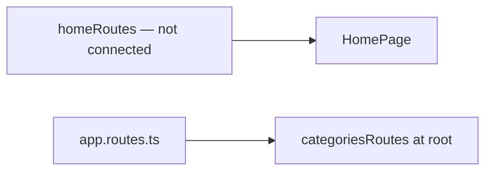

# Storefront Home — exists but is not connected

**Status:** [homeRoutes](../../../libs/storefront/feature/home/src/lib/lib.routes.ts) and [HomePage](../../../libs/storefront/feature/home/src/lib/page/home-page/home-page.ts) exist, but [app.routes.ts](../../../apps/storefront/src/app/app.routes.ts) does not import `homeRoutes`. The localized root is currently served by [categoriesRoutes](../../../libs/storefront/feature/categories/src/lib/lib.routes.ts).

Before activation, determine root route order and check the actual page contents. Do not treat this library as the active home page.

## Architecture



## Code structure

Actual entry points and primary feature files (other files in these directories are omitted):

```text
apps/storefront/src/app/
└── app.routes.ts  # feature routes

libs/storefront/feature/categories/
└── src/lib/lib.routes.ts  # feature routes

libs/storefront/feature/home/
└── src/lib/
    ├── page/home-page/home-page.ts  # page and UI composition
    └── lib.routes.ts  # feature routes
```
