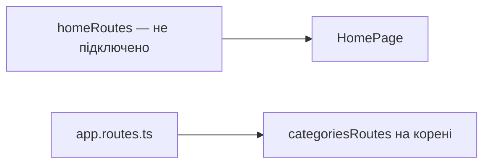

# Home Storefront — наявний, не підключений

**Стан:** [homeRoutes](../../../libs/storefront/feature/home/src/lib/lib.routes.ts) та [HomePage](../../../libs/storefront/feature/home/src/lib/page/home-page/home-page.ts) існують, але [app.routes.ts](../../../apps/storefront/src/app/app.routes.ts) не імпортує `homeRoutes`. Локалізований корінь зараз обслуговує [categoriesRoutes](../../../libs/storefront/feature/categories/src/lib/lib.routes.ts).

Перед активацією визнач порядок root-маршрутів і перевір фактичний склад сторінки. Не вважай цю бібліотеку активною головною сторінкою.

## Схема будови



## Структура в коді

Фактичні точки входу й основні файли фічі (інші файли цих каталогів тут не перелічено):

```text
apps/storefront/src/app/
└── app.routes.ts  # маршрути фічі

libs/storefront/feature/categories/
└── src/lib/lib.routes.ts  # маршрути фічі

libs/storefront/feature/home/
└── src/lib/
    ├── page/home-page/home-page.ts  # сторінка та композиція UI
    └── lib.routes.ts  # маршрути фічі
```
