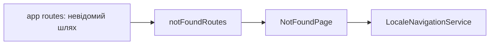

# Сторінка 404 Storefront

**Вхід:** [notFoundRoutes](../../../libs/storefront/feature/not-found/src/lib/lib.routes.ts) відкриває `/404`; [app routes](../../../apps/storefront/src/app/app.routes.ts) перенаправляє невідомі шляхи на локалізований 404.

- [NotFoundPage](../../../libs/storefront/feature/not-found/src/lib/page/not-found-page/not-found-page.ts) відображає стан відсутньої сторінки. `LocaleNavigationService` зберігає поточну мову при переході.

## Схема будови



## Структура в коді

Фактичні точки входу й основні файли фічі (інші файли цих каталогів тут не перелічено):

```text
apps/storefront/src/app/
└── app.routes.ts  # маршрути фічі

libs/storefront/feature/not-found/
└── src/lib/
    ├── page/not-found-page/not-found-page.ts  # сторінка та композиція UI
    └── lib.routes.ts  # маршрути фічі
```
