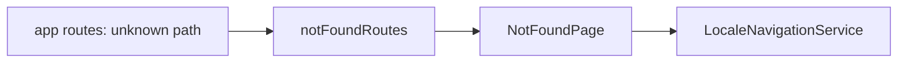

# Storefront 404 Page

**Entry point:** [notFoundRoutes](../../../libs/storefront/feature/not-found/src/lib/lib.routes.ts) opens `/404`; [app routes](../../../apps/storefront/src/app/app.routes.ts) redirects unknown paths to the localized 404.

- [NotFoundPage](../../../libs/storefront/feature/not-found/src/lib/page/not-found-page/not-found-page.ts) displays the page-not-found state. `LocaleNavigationService` preserves the current language during navigation.

## Architecture



## Code structure

Actual entry points and primary feature files (other files in these directories are omitted):

```text
apps/storefront/src/app/
└── app.routes.ts  # feature routes

libs/storefront/feature/not-found/
└── src/lib/
    ├── page/not-found-page/not-found-page.ts  # page and UI composition
    └── lib.routes.ts  # feature routes
```

## Tests

No automated tests cover this feature yet.
