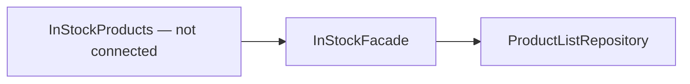

# Storefront In-stock Widget — exists but is not connected

**Status:** [InStockProducts](../../../libs/storefront/feature/widgets/src/lib/in-stock-products/in-stock-products.ts) and [InStockFacade](../../../libs/storefront/feature/widgets/src/lib/in-stock-products/in-stock.facade.ts) exist, but the application does not import this widget.

The facade reads products through [ProductListRepository](../../../libs/storefront/data-access/src/lib/catalog/repositories/product-list.repository.ts). Before connecting it to a page, check its loading state and reuse of the [catalog](catalog/catalog.md).

## Architecture



## Code structure

Actual entry points and primary feature files (other files in these directories are omitted):

```text
libs/storefront/data-access/
└── src/lib/catalog/repositories/product-list.repository.ts  # feature implementation

libs/storefront/feature/widgets/
└── src/lib/in-stock-products/
    ├── in-stock-products.ts  # feature implementation
    └── in-stock.facade.ts  # state and data interaction
```

## Tests

Spec files sit next to the code in each project. Focused runs:

- `libs/storefront/data-access` (3 spec files): `npx nx run storefront-data-access:vite:test -- --run`

Without tests: `widgets`.
