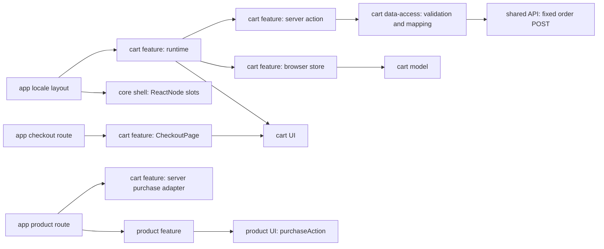

# Frontend: архитектура и карта файлов

## Граница

Только `apps/site`, новый домен `libs/site/cart/*`, непосредственные composition points shell/product и узкий server-only transport общего API client. Старый storefront служит источником поведения; импортов Angular, Admin, RTK Query и session guards в Site нет. [Проектные направления зависимостей](../../../../../architecture/site/structure/modules.md) и [правила поставки](../../../../../standards/shared/delivery-rules.md) имеют приоритет.

## Архитектурный базис на 2026-11-03

| Область             | Фактический источник                                                                                                                | Целевое решение                                                                                                     | Подготовка         |
| ------------------- | ----------------------------------------------------------------------------------------------------------------------------------- | ------------------------------------------------------------------------------------------------------------------- | ------------------ |
| Домен cart          | `libs/site/cart` отсутствует; текущая карточка `docs/features/site/product.md` отмечает EN-002                                      | Пять Nx libraries model/data-access/ui/seo/feature; `scope:site`, `domain:cart`, соответствующие type tags          | EN-001             |
| Aliases / API       | `tsconfig.base.json`, пример `libs/site/product/model/project.json` и его `src/index.ts`                                            | `@site/cart/<layer>`, только public index; приватные относительные импорты внутри своего проекта                    | EN-001             |
| Shell               | `site-shell.tsx` принимает children/locale/catalogNavigation; header и compact actions имеют отдельные checkout links               | Generic `ReactNode` slots без импорта cart в core                                                                   | EN-002             |
| Покупка товара      | `product/feature/.../product-page.tsx` получает ProductDetails; `product/ui/.../product-detail-view.tsx` уже имеет `purchaseAction` | Серверный callback создаёт узел через adapter, переданный app route                                                 | EN-003, TS-009     |
| Транспорт           | `site-shared-api-client` server-only, `siteApiGet` разрешает лишь `/api/catalog/*`                                                  | Отдельный whitelisted POST только `/api/orders`, затем domain projection; GET не расширять до произвольных endpoint | TS-006             |
| Владение состоянием | Site cart/provider отсутствуют; root layout находится в `app/[locale]/layout.tsx`                                                   | External store только в браузере, общий на текущий document; provider подписывается через React                     | TS-003             |
| Зависимости         | `tools/architecture/project-boundary-rules.mjs`, `eslint.config.cjs`: feature→feature запрещён                                      | app собирает feature exports; ни product feature→cart feature, ни core shell→cart                                   | EN-002/003, TS-009 |
| Проверки            | `vite.config.mts` и `project.json` product libraries, `nx.json`, npm scripts                                                        | Новые focused targets подтверждаются EN-001; текущие targets не выдаются за существующие cart targets               | EN-001             |

Таблица выше фиксирует исходный базис подготовки SDD. На 2026-11-04 prerequisites EN-001/002/003 выполнены, архитектурные документы синхронизированы. Локальное [ревью реализации](../code-audit/audit.md) не обнаружило открытых in-scope нарушений после исправления AF-001; общая remediation SDD не нужна.

Исходная особенность guard: `site-core-shell` имеет `type:shell`, а не `type:core`. Один запрет type:core→domain не доказывает корректность shell imports; отсутствие cart/domain imports в shell проверяется отдельно. Для первоначальной server injection новый flow не понадобился. Последующий аудит AF-005 добавил один cart-feature→product-model flow: cartViewProps использует публичную canonical product path policy; UI получает productHref. AF-006 добавил явный Site shell fence в ESLint и validator.

## Ответственности и public API

| Владелец                 | Одна ответственность                                                             | Фактический public API                                                                        |
| ------------------------ | -------------------------------------------------------------------------------- | --------------------------------------------------------------------------------------------- |
| `site-cart-model`        | Чистые модели/инварианты, commands, quantity, totals, validation                 | CartLineSeed, CartLine, CheckoutDraft, CheckoutResult, selectors/reducer/validators           |
| `site-cart-data-access`  | Только server-only DTO mapping, response parsing и нормализация createQuickOrder | `createQuickOrder(command)` → сериализуемый доменный результат                                |
| `site-cart-ui`           | Props/callbacks для строк, drawer, формы, empty/error/success; без транспорта    | CartDrawer, CheckoutView, CartPurchaseControl, CartLineView/productHref и локализованная copy |
| `site-cart-seo`          | Неперсональные приватные metadata                                                | `buildCheckoutMetadata(locale)`                                                               |
| `site-cart-feature`      | Orchestration, browser owner, storage adapter, controllers и server action       | CartRuntime, CartHeaderAction, CheckoutPage, `renderCartPurchaseAction`                       |
| `site-shared-api-client` | HTTP только к фиксированной разрешённой операции                                 | `siteApiCreateQuickOrder` отдельно от `siteApiGet`                                            |

Клиентские файлы не импортируют data-access или общий API client. Server-only data-access и client store не смешиваются в клиентском barrel. Общий `cart/feature/src/index.ts` используется серверной app composition; внутри client leaves — относительные импорты своих client modules. Server Function передаётся клиентскому runtime как action prop, UI получает обычные callbacks и mapped models.

## Интеграция без циклов

ProductPage получает optional `renderPurchaseAction(descriptor): ReactNode`. Он формирует descriptor **после** нормализации товара и выполняет callback на сервере; в client leaf уходит только сериализуемый seed. App product route передаёт готовый function export cart adapter без fetch, DTO mapping или правил покупки в route. Descriptor структурный: productId, title, unitPrice, currency, slug, imageUrl и available; `ProductDetails.sku` уже является строковым product.id. Product feature не импортирует cart, cart adapter не импортирует product; совместимость их public signatures проверяется TypeScript.

Runtime монтируется в существующем locale layout под ThemeProvider и оборачивает SiteShell/children. Он передаёт серверную action клиентскому provider и монтирует **один** drawer. Основной и компактный cart slots получают consumers одного owner. Server Components, переданные children, не превращаются в client code.

## Состояние, хранение и жизненный цикл

- Client-only external store находится в cart/feature, создаётся только после проверки браузерной среды. React `useSyncExternalStore` получает стабильные immutable snapshots и детерминированный `getServerSnapshot`; серверного singleton с корзиной/PII нет.
- Store живёт в пределах текущего document и переживает remount provider при soft locale navigation. Root layout `[locale]` сам по себе не является доказательством сохранности useState. Hard reload сбрасывает контакты, но восстанавливает допустимую корзину.
- Browser storage adapter читает `cart_v1` только после hydration. Начальный статус `restoring`; пустая корзина и submit недоступны до окончания чтения. Валидация и partial recovery — в [модели данных](../data-model.md).
- Сохраняются только строки корзины. Имя, телефон, серверные field errors и orderId не пишутся в localStorage, URL или analytics. Ошибки storage не приводят к падению.
- Во время pending owner фиксирует immutable command, блокирует изменение корзины и контактов, принимает только один вызов. Смена темы/языка или закрытие drawer не повторяет и не отменяет операцию.
- После подтверждённого UUID очищаются строки, draft и persistent cart; receipt хранится в памяти отдельно от пустого cart state. Ошибка удаления storage не превращает подтверждённый заказ в failed/retry.

## Компактная карта файлов

Все пути ниже относительно корня репозитория. Пять библиотек созданы Nx-генератором, затем configs приведены к текущим product conventions.

| Путь                                                                                                                                                      | Состояние        | Ответственность                                    | Задача         |
| --------------------------------------------------------------------------------------------------------------------------------------------------------- | ---------------- | -------------------------------------------------- | -------------- |
| `libs/site/cart/model/src/lib/cart/`                                                                                                                      | реализовано      | types, pure reducer, quantity и totals             | TS-001         |
| `libs/site/cart/model/src/lib/checkout/`                                                                                                                  | реализовано      | draft validation, command/result types             | TS-001         |
| `libs/site/cart/feature/src/lib/storage/cart-storage.ts`                                                                                                  | реализовано      | browser IO и legacy decode orchestration           | TS-002         |
| `libs/site/cart/model/src/lib/persistence/cart-persistence.ts`                                                                                            | реализовано      | чистый legacy parser/serializer                    | TS-002         |
| `libs/site/cart/feature/src/lib/state/`                                                                                                                   | реализовано      | document store, subscription, pending lifecycle    | TS-003, TS-007 |
| `libs/site/cart/feature/src/lib/runtime/cart-runtime.tsx`                                                                                                 | реализовано      | server composition provider/action/drawer          | TS-009         |
| `libs/site/cart/feature/src/lib/runtime/cart-provider.tsx`                                                                                                | реализовано      | client subscription/context bridge                 | TS-003         |
| `libs/site/cart/ui/src/lib/cart/`                                                                                                                         | реализовано      | строки, quantity, presentational drawer            | TS-004         |
| `libs/site/cart/feature/src/lib/cart/`                                                                                                                    | реализовано      | header/drawer controllers                          | TS-004         |
| `libs/site/cart/ui/src/lib/checkout/`                                                                                                                     | реализовано      | contacts, totals, loading/empty/error/receipt      | TS-005         |
| `libs/site/cart/ui/src/lib/i18n/`                                                                                                                         | реализовано      | типизированная UK/RU copy                          | TS-004/005     |
| `libs/site/cart/feature/src/lib/checkout/`                                                                                                                | реализовано      | серверная checkout composition и client controller | TS-005/007/008 |
| `libs/site/shared/api-client/src/lib/site-order-api.ts`                                                                                                   | реализовано      | фиксированный anonymous POST, no-store, без retry  | TS-006         |
| `libs/site/cart/data-access/src/lib/contracts/`                                                                                                           | реализовано      | private generated aliases, runtime parsers         | TS-006         |
| `libs/site/cart/data-access/src/lib/orders/`                                                                                                              | реализовано      | order mapper и normalized result                   | TS-006         |
| `libs/site/cart/feature/src/lib/actions/submit-quick-order.ts`                                                                                            | реализовано      | public Server Function с валидацией unknown input  | TS-006         |
| `libs/site/cart/seo/src/lib/checkout-metadata.ts`                                                                                                         | реализовано      | noindex metadata без canonical/alternates/PII      | TS-008         |
| `apps/site/src/app/[locale]/checkout/page.tsx`                                                                                                            | реализовано      | thin route и metadata delegation                   | TS-008         |
| `apps/site/src/app/[locale]/layout.tsx`                                                                                                                   | подключено       | app composition CartRuntime и generic shell slots  | TS-009         |
| `libs/site/core/shell/src/lib/site-shell.tsx` и `header/{site-header.tsx,bars/main-bar.tsx,bars/category-bar.tsx,header-actions.tsx,compact-actions.tsx}` | slots подключены | провести generic slots; не добавлять cart state    | EN-002         |
| `libs/site/product/feature/src/lib/detail/product-page.tsx`                                                                                               | подключено       | вызвать server purchase renderer                   | EN-003         |
| `libs/site/product/feature/src/lib/detail/product-purchase-descriptor.ts`                                                                                 | реализовано      | mapping своего product model в public descriptor   | EN-003         |
| `libs/site/cart/feature/src/lib/purchase/`                                                                                                                | реализовано      | server adapter и client purchase binding           | TS-009         |
| `apps/site/src/app/[locale]/product/[slug]/page.tsx`                                                                                                      | подключено       | передать готовый cart renderer                     | TS-009         |
| `docs/features/site/cart.md`                                                                                                                              | реализовано      | фактическая короткая карточка после реализации     | TS-010         |

Небольшие существующие composition files сохраняются цельными. Новые state/storage/transport/validators/UI не помещаются в route, SiteShell или один checkout component. Фактические test paths закреплены в task Evidence/traceability, дерево — в feature card.

## Подход и инструменты

По текущему `package-lock.json`: Next 16.4.3, React/React DOM 19.3.0, Zod 4.6.7, Tailwind 4.3.3, lucide-react 1.66.0; Nx React 24.0.3, Vitest 5.0.5, Testing Library React 16.3.3, jsdom 30.1.3. Новые state/data packages не нужны. React external store выбран для document lifetime без server singleton и без постоянного хранения контактов.

UI использует существующие Onest/JetBrains Mono, tokens, Button и Sheet; отсутствующие нужные primitives добавляются shadcn generator из `libs/site/shared/ui`. Пакетные версии не копируются в каждый task. Next API сверены с локальными `07-mutating-data.md`, `server-actions.md`, `connection.md`; [Next.js design](nextjs.md) фиксирует точные пути.

Проверки выбираются по [testing rules](../../../../../standards/shared/testing-rules.md): unit для инвариантов; focused integration для storage/hydration/owner/transport; component для доступных состояний. Полный graph, build, E2E и browser не требуются для SDD. В реализации EN-001 подтверждает реальные Nx targets до запуска зависимых задач.

## Уточнение после архитектурного аудита

[AF-003–006](../code-audit/audit.md) verified. Новый существующий путь libs/site/cart/feature/src/lib/platform/cart-drawer-focus.ts владеет только DOM visibility/viewport/focus; cart-client-store делегирует его remember/restore и сохраняет единый atomic business state. Динамический productHref принадлежит cart/cart-view-props.ts, использующему public product model paths; CartLine отображает готовый destination. Роли model/data-access/action/runtime остаются прежними.
