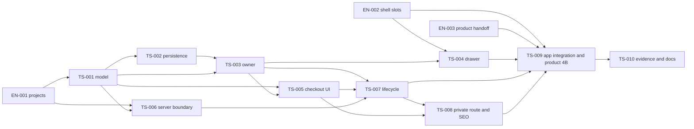

# Граф реализации корзины и заказа

Номер не задаёт порядок исполнения. Все EN/TS выполнены по прямому разрешению пользователя от 2026-11-04; статусы относятся к коду и автоматическим/source проверкам. Build/HTTP/browser/E2E/deployment не запускались.

| ID                                                    | Ответственность                                        | Covers / Enables                                                                                                                                                                                                                                       | Depends on                             | Статус                |
| ----------------------------------------------------- | ------------------------------------------------------ | ------------------------------------------------------------------------------------------------------------------------------------------------------------------------------------------------------------------------------------------------------ | -------------------------------------- | --------------------- |
| [EN-001](enablers/EN-001-cart-foundation.md)          | Nx-проекты cart и узкий test harness                   | Enables SC-001, SC-002, SC-003, SC-004, SC-005, SC-006, SC-007, SC-008, SC-009, SC-010, SC-011, SC-012, SC-013, SC-014, SC-015, SC-016, SC-017, SC-018, SC-019, SC-020, SC-021, SC-022, SC-023, SC-024, SC-025, SC-026, SC-027, SC-028, SC-029, SC-030 | —                                      | implemented, verified |
| [EN-002](enablers/EN-002-shell-cart-slots.md)         | Generic cart slots существующего SiteShell             | Enables SC-003, SC-022, SC-027                                                                                                                                                                                                                         | —                                      | implemented, verified |
| [EN-003](enablers/EN-003-product-purchase-handoff.md) | Серверный purchase handoff карточки товара             | Enables SC-001, SC-002, SC-027                                                                                                                                                                                                                         | —                                      | implemented, verified |
| [TS-001](TS-001-cart-model.md)                        | Чистая модель корзины и валидация заказа               | Covers SC-001, SC-002, SC-003, SC-004, SC-010, SC-011, SC-021                                                                                                                                                                                          | EN-001                                 | implemented, verified |
| [TS-002](TS-002-legacy-persistence.md)                | Совместимое восстановление и сохранение cart_v1        | Covers SC-006, SC-007, SC-008, SC-009, SC-014, SC-030                                                                                                                                                                                                  | TS-001                                 | implemented, verified |
| [TS-003](TS-003-client-owner.md)                      | Один browser owner и сохранность draft при remount     | Covers SC-001, SC-003, SC-009, SC-013, SC-014, SC-015, SC-027                                                                                                                                                                                          | TS-001, TS-002                         | implemented, verified |
| [TS-004](TS-004-cart-drawer.md)                       | Представления и контроллеры корзины из шапки           | Covers SC-003, SC-004, SC-005, SC-012, SC-022, SC-024                                                                                                                                                                                                  | TS-003, EN-002                         | implemented, verified |
| [TS-005](TS-005-checkout-view.md)                     | Двухколоночный checkout и локальные состояния формы    | Covers SC-004, SC-005, SC-010, SC-011, SC-012, SC-021, SC-023, SC-024                                                                                                                                                                                  | TS-001, TS-003                         | implemented, verified |
| [TS-006](TS-006-order-boundary.md)                    | Серверная контрактная граница createQuickOrder         | Covers SC-015, SC-016, SC-017, SC-018, SC-019, SC-020, SC-028, SC-029                                                                                                                                                                                  | EN-001, TS-001                         | implemented, verified |
| [TS-007](TS-007-checkout-lifecycle.md)                | Жизненный цикл отправки и подтверждения в общем owner  | Covers SC-013, SC-015, SC-016, SC-017, SC-018, SC-019, SC-020, SC-029, SC-030                                                                                                                                                                          | TS-003, TS-005, TS-006                 | implemented, verified |
| [TS-008](TS-008-checkout-route-seo.md)                | Приватный checkout route и metadata                    | Covers SC-012, SC-025, SC-026, SC-028                                                                                                                                                                                                                  | TS-005, TS-007                         | implemented, verified |
| [TS-009](TS-009-app-cart-composition.md)              | Подключение общего runtime к shell, checkout и покупке | Covers SC-001, SC-002, SC-003, SC-013, SC-015, SC-022, SC-023, SC-024, SC-027                                                                                                                                                                          | EN-002, EN-003, TS-004, TS-007, TS-008 | implemented, verified |
| [TS-010](TS-010-verification-and-docs.md)             | Финальное evidence и фактическая документация функции  | Covers SC-001, SC-002, SC-003, SC-004, SC-005, SC-006, SC-007, SC-008, SC-009, SC-010, SC-011, SC-012, SC-013, SC-014, SC-015, SC-016, SC-017, SC-018, SC-019, SC-020, SC-021, SC-022, SC-023, SC-024, SC-025, SC-026, SC-027, SC-028, SC-029, SC-030  | TS-009                                 | implemented, verified |

[UI-фаза](03-react-web-ui.md) и [SEO-фаза](09-seo.md) группируют task files. Внешний product:EN-002 закрыт producer evidence cart; product:TS-005 выполнен через TS-009 без дублирования интеграции. Старые ID и 4A evidence сохранены.

Nx targets созданы EN-001. Реально выполненные direct Vitest команды по тем же configs и scoped проверки перечислены в [implementation evidence](../verification/implementation.md); полный test:site не запускался.
