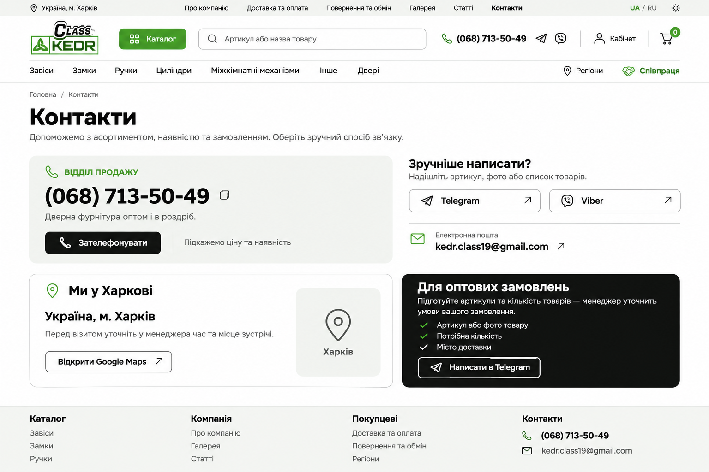

# 001 — Страница контактов Class Kedr

- **Клиент:** публичный Next.js Site (`apps/site`).
- **Домен:** `content`, часть шага 6 [миграции](../../migration/README.md).
- **Статус:** СДД согласована; реализация выполнена, итоговые проверки — в [отчёте](verification/implementation.md).
- **Создано / обновлено:** 2026-11-02.
- **Ответственный за согласование:** владелец продукта; за выполнение задач — разработчик страницы.
- **Основание:** владелец одобрил визуальный концепт и затем разрешил реализацию этой СДД в чате 2026-11-02.

Посетитель `/{locale}/contacts` видит телефон отдела продаж, Telegram, Viber, почту, информацию о расположении в Харькове и памятку для оптового обращения. Данные и ссылки доступны в исходном HTML; звонок и переходы работают без клиентского JavaScript. Копирование телефона — отдельное улучшение с явной обратной связью.

## Документы

- [Границы и источники](requirements/overview.md).
- [Правила и приёмочные сценарии](requirements/behavior.md).
- [Тексты двух языков](requirements/content.md).
- [Архитектура и карта файлов](design/frontend.md).
- [Next.js: маршруты и рендеринг](design/nextjs.md).
- [SEO](design/seo.md).
- [Задачи и зависимости](tasks/README.md).
- [Трассировка](traceability.md).
- [Готовность СДД](checklist/spec-readiness.md), [готовность Next.js и SEO](checklist/nextjs-seo-readiness.md), [готовность реализации](checklist/delivery-readiness.md).
- [План проверки SEO](verification/seo-verification.md).
- [Выполнение и доказательства](verification/implementation.md), [карточка функции](../../../../features/site/contacts.md).
- [Аудит архитектуры и ответственностей](code-audit/audit.md), локальный рефакторинг TS-005.

## Визуальная основа

Изображение определяет композицию. Рабочие токены, существующая шапка, подвал и типографика берутся из [дизайн-системы](../../../../standards/site/design-system.md); мелкие артефакты генерации изображения не являются требованиями. Точные тексты и поведение заданы этой СДД. Светлый desktop-концепт одобрен; мобильная компоновка и применение существующей тёмной темы согласованы вместе с СДД.

## Состояние и решения

- Добавлены маршрут контактов, библиотеки `content/{ui,seo,feature}`, sitemap и карточка функции; общий shell, `COMPANY` и Angular не изменены.
- Продуктовых блокеров для указанной страницы нет. СДД согласована в чате 2026-11-02.
- Полный адрес, график, фотографии команды, форма обратной связи и отправка обращений через API не входят в эту версию. Их отсутствие не блокирует страницу с подтверждёнными каналами связи.
- `LocalBusiness` / `Store` остаются будущей задачей после предоставления данных владельцем. Эта версия использует `ContactPage`, `BreadcrumbList` и существующую `Organization`.
- Публикация, переключение домена и включение индексации — отдельные этапы миграции.

## История

- 2026-11-02 — визуальный концепт одобрен в чате; подготовлена СДД до начала реализации.
- 2026-11-02 — СДД согласована, реализованы обе локали, копирование телефона, metadata, JSON-LD и sitemap. Description использует форму «Class Kedr, Харків/Харьков», чтобы подставлять город из `COMPANY` без второй копии его склонения.
- 2026-11-02 — по запросу владельца проведён аудит frontend-code-audit; clipboard lifecycle выделен из визуального компонента в приватный hook, поведение и контракты сохранены (TS-005).
