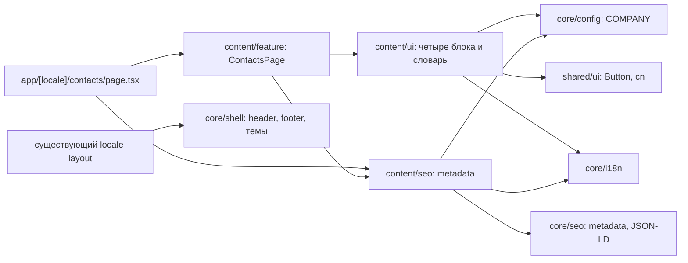

# Контакты — frontend-дизайн

## Правила и текущий базис

Применяются `AGENTS.md`, `apps/site/AGENTS.md`, [архитектура Site](../../../../../architecture/site/README.md), [модули](../../../../../architecture/site/structure/modules.md), [delivery rules](../../../../../standards/shared/delivery-rules.md) и [дизайн-система](../../../../../standards/site/design-system.md).

Исходный базис до реализации, проверенный по файлам 2026-11-02. После внедрения фактическое дерево и выполненные проверки приведены в [карточке функции](../../../../../features/site/contacts.md) и [отчёте](../verification/implementation.md):

| Область      | Фактическое состояние                                                                                         | Решение для контактов                                                                      |
| ------------ | ------------------------------------------------------------------------------------------------------------- | ------------------------------------------------------------------------------------------ |
| Приложение   | `site`: `scope:site`, `type:app`; App Router, Cache Components включён                                        | Новый тонкий маршрут внутри существующего `[locale]`                                       |
| Домен        | `libs/site/content` пока отсутствует; шаг 6 миграции уже закрепляет контент за `content`                      | Три библиотеки `content/{ui,seo,feature}`; отдельный домен `contacts` не нужен             |
| Общие данные | `site-core-config` и `site-core-i18n`: `scope:site`, `scope:site-shared`, `type:util`                         | `COMPANY`, `Locale`, `localizedPath` через публичные index                                 |
| SEO          | `site-core-seo`: `scope:site`, `scope:site-shared`, `type:core`; `Organization` уже в layout                  | Общие metadata и сериализация; domain SEO владеет данными контактов                        |
| UI           | `site-shared-ui`: shadcn `Button`, `cn`; темы в `global.css`                                                  | Без новых UI-зависимостей и изменения токенов                                              |
| Оболочка     | `SiteShell`, переключатели языка/темы, существующие `/contacts` ссылки                                        | Переиспользовать без второго header/footer                                                 |
| Копирование  | `CopyPhoneButton` находится внутри shell, не экспортируется и при ошибке вызывает звонок                      | Локальная минимальная client-кнопка контактов с поведением R-004; shell не меняется        |
| Зависимости  | Статические импорты страницы → feature / SEO; общая оболочка → catalog feature; site content ещё нет          | Новые импорты только внутри content и в core/shared; новые cross-domain flows не требуются |
| Ограничения  | `eslint.config.cjs` и `project-boundary-rules.mjs`: нет feature → feature, UI → data-access, core → domain    | Сохранять ограничения; не ослаблять валидатор ради страницы                                |
| Тесты        | По `nx show project site-home-ui --json` подтверждены inferred `vite:test`, `typecheck`, `lint`; Vitest/jsdom | Новые цели проверить после генерации; до неё не считать существующими                      |

Версии из `package.json` и lockfile: Next.js 16.4.3, React 19.3.0, Nx React 24.0.3, Vitest 5.0.5. Открыты установленные руководства `node_modules/next/dist/docs/01-app/03-api-reference/03-file-conventions/page.md` и `01-app/01-getting-started/08-caching.md`. Новых пакетов, модели данных, DTO, запросов или API-контрактов не нужно.

Проверка ограничена затронутой цепочкой и конфигурацией; полный аудит и запуск валидатора графа в этапе СДД не выполняются. Подтверждённых блокирующих `AF-*` в этой цепочке не обнаружено. Новые теги, aliases и фактические рёбра графа проверяются в EN-001 и TS-004, до объявления реализации готовой.

## Целевые зависимости

## Планируемая карта файлов

Все новые библиотеки создаются Nx-генератором. Теги: `scope:site`, `domain:content`, `type:ui|util|feature` (SEO — `type:util`). Конфигурация приводится к существующему примеру `home/*`, включая `resolve.tsconfigPaths`; публичные импорты только через `src/index.ts`.

| Точный путь                                                   | Одна ответственность                                       | Состояние                                                               |
| ------------------------------------------------------------- | ---------------------------------------------------------- | ----------------------------------------------------------------------- |
| `apps/site/src/app/[locale]/contacts/page.tsx`                | Параметры локали, вызов feature и domain metadata          | Новый                                                                   |
| `libs/site/content/feature/src/lib/contacts-page.tsx`         | Композиция блоков, крошек и JSON-LD                        | Новый                                                                   |
| `libs/site/content/feature/src/lib/contacts-sitemap.ts`       | Запись пути `/contacts` для sitemap                        | Новый                                                                   |
| `libs/site/content/ui/src/lib/contacts/contacts-heading.tsx`  | Крошки, H1 и вводный текст                                 | Новый                                                                   |
| `libs/site/content/ui/src/lib/contacts/sales-contact.tsx`     | Телефон и действие звонка                                  | Новый                                                                   |
| `libs/site/content/ui/src/lib/contacts/copy-phone-button.tsx` | Клиентская операция копирования и её состояния             | Новый                                                                   |
| `libs/site/content/ui/src/lib/contacts/written-channels.tsx`  | Telegram, Viber и email                                    | Новый                                                                   |
| `libs/site/content/ui/src/lib/contacts/location-card.tsx`     | Город, уточнение визита и Maps                             | Новый                                                                   |
| `libs/site/content/ui/src/lib/contacts/wholesale-contact.tsx` | Оптовая памятка и Telegram                                 | Новый                                                                   |
| `libs/site/content/ui/src/lib/i18n/contacts-dictionary.ts`    | Типизированные uk/ru тексты                                | Новый                                                                   |
| `libs/site/content/seo/src/lib/contacts-metadata.ts`          | Путь `/contacts` и локализованные metadata                 | Новый                                                                   |
| `libs/site/content/seo/src/lib/contacts-json-ld.ts`           | `ContactPage` и `BreadcrumbList`                           | Новый                                                                   |
| `libs/site/content/{ui,seo,feature}/src/index.ts`             | Публичные точки входа библиотек                            | Новые                                                                   |
| `apps/site/src/app/sitemap.ts`                                | Включение контактов в существующую сборку sitemap          | Изменить существующий                                                   |
| `tsconfig.base.json`                                          | Три aliases `@site/content/{ui,seo,feature}`               | Изменить существующий                                                   |
| `package.json`                                                | Включение новых проектов в `test:site` для последующего CI | Изменить существующий при реализации; полный скрипт сейчас не запускать |

Существующие layout, shell, `COMPANY`, кнопка shell и общие metadata сохраняют своих владельцев. `sitemap.ts` остаётся точкой композиции. Нет перегруженного существующего файла, который необходимо разделить для этой задачи. После каждого слоя проверяется соответствие ответственности карте; самостоятельные блоки не собираются в один большой UI-файл.

## Компоновка и темы

- Основная ширина и отступы наследуются от `SiteShell`: до 90rem, 16 px по бокам, от `lg` 24 px. Не создавать вложенный `<main>`.
- Desktop от `lg` (1024 px): двухколоночная сетка `minmax(0,1.3fr) minmax(0,1fr)`, первый ряд — телефон / письменные каналы, второй — расположение / опт. Зазоры 24–32 px.
- Ниже `lg`: один столбец в порядке R-008. Внутренние отступы панелей 20–24 px, на desktop до 32 px. Кнопки/подписи переносятся; номер масштабируется от примерно 28 px до 40 px, почта допускает перенос. Минимальная ширина контента — 320 px.
- Телефонная панель `bg-muted`, остальные светлые панели `bg-background`, границы `border-border`. Тексты `foreground`, `muted-foreground`, зелёный текст `brand-text`. Собственные hex-цвета не добавлять.
- Оптовая панель использует локальную `.dark` и соответствующие background/foreground/border, как существующий `WholesalePanel`; остаётся тёмной в обеих темах. Основное действие телефона — `Button` default, каналы и Maps — outline.
- Иконки lucide со stroke 1.75, декоративные `aria-hidden`. Никаких нарисованных товаров, фото-заглушек и географической карты: только нейтральная плашка с pin и городом, как в концепте.

## Состояния и доступность

Уточнение TS-005 после аудита 2026-11-02: `libs/site/content/ui/src/lib/hooks/use-copy-phone.ts` — отдельный приватный владелец clipboard/state/timer; `contacts/copy-phone-button.tsx` отображает кнопку и локализованный live region. Публичный index, пропсы и server/client граница сохраняются. Это фактическое разделение добавлено к исходной карте файлов; [аудит](../code-audit/audit.md) содержит решения split/keep.

Статические тексты не имеют отдельной загрузки, пустого списка или запроса. Ошибки маршрута обслуживаются существующей оболочкой. Изменяемое состояние существует только у копирования: idle → pending → success / error, с очисткой таймера при размонтировании. У кнопки — доступное имя; у результата — live region; ошибка не меняет местоположение или фокус.

Порядок DOM совпадает с чтением на телефоне и клавиатурной навигацией. Не делать CSS-перестановку с неожиданным порядком Tab. Крошки — nav с доступным именем, текущий пункт `aria-current="page"`, один H1; названия блоков — H2. Телефон остаётся выделяемым текстом. Звонок, мессенджеры, Maps и почта — настоящие `<a href>`; внутренние крошки — Next `Link`.
