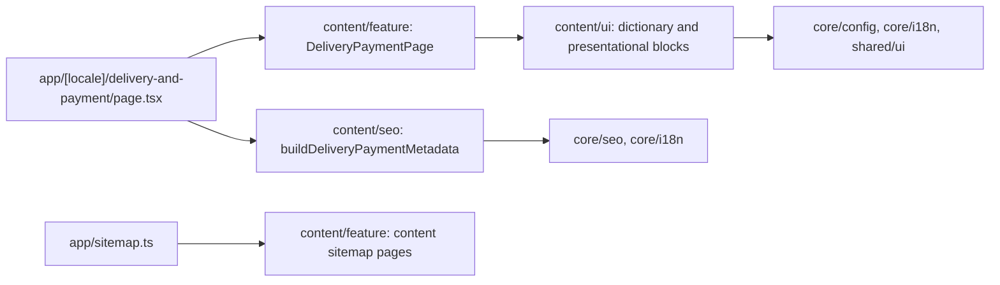

# Frontend design

## Applicable project rules and baseline

Read against `AGENTS.md`, `apps/site/AGENTS.md`, the site architecture/module map and design system linked from the specification README. Existing site libraries use public `src/index.ts` aliases in `tsconfig.base.json`, Nx `scope:site` and domain/type tags. `eslint.config.cjs` and `tools/architecture/project-boundary-rules.mjs` own dependency enforcement; verify newly generated projects with `npm run architecture:boundaries`.

The delivery URL, Next.js page and content libraries are implemented; shell navigation retains the same route. Current Angular content is a read-only migration source. Existing home UI/SEO/feature libraries establish the local layer convention. Existing `core/seo` provides metadata/sitemap builders, `core/config` owns COMPANY, `core/i18n` owns locale handling, and `shared/ui` provides Button. The requested follow-up audit confirmed lint-cache configuration finding AF-001; it is repaired and verified in TS-005. No runtime boundary or UI-responsibility finding remains.

Package manifest: Next 16.4.3, React 19.3.0, lucide-react 1.66.0, Tailwind ^4.3.3. Reuse installed packages and the current lockfile. No added package, data layer, API operation or generated contract is needed. Static dictionaries belong to content/ui; domain SEO owns independent metadata copy.

## Accepted visual structure

Use [concept.png](concept.png) as the owner-approved visual reference: existing shell, breadcrumbs, a strong page title and short source introduction, compact section anchors, side-by-side delivery/payment terms on desktop, four order steps on a muted surface, important conditions/offer and a contact action. On phones stack terms and steps in a readable single column. Preserve full text rather than reproducing spelling artifacts from the raster.

Use Onest, existing Tailwind CSS tokens, 1440px site container/gutters, 8px button radius and 10–16px panel radii. Neutral backgrounds and muted text carry content; green text uses `brand-text`; icons use lucide strokeWidth 1.75. Contact uses the existing shared Button styling. Existing SiteShell owns header, footer, language and theme controls. No custom theme, font/CDN or replacement shell.

Use semantic heading order, ordered steps, lists for terms, named anchor targets, visible focus and normal crawlable links. There is one H1. Existing themes work through inherited tokens; no page-specific theme state. No disclosure hides essential terms. No additional motion is necessary.

## Responsibilities and dependencies

Only public library exports are imported. No site import from storefront/admin; Angular strings are copied as source material. No cross-domain feature import. Static page composition has no state, store, fetch, mapper, Server Action or client island.

## Verified file-role map

| Path                                                                                                                                      | State  | Single role / owner                                                                              |
| ----------------------------------------------------------------------------------------------------------------------------------------- | ------ | ------------------------------------------------------------------------------------------------ |
| `libs/site/content/{ui,seo,feature}/project.json`, `vite.config.mts`, tsconfigs, public `src/index.ts`; root `tsconfig.base.json` aliases | exists | Generator scaffolding and explicit tags; coordinator EN-001                                      |
| `libs/site/content/ui/src/lib/i18n/delivery-payment-dictionary.ts`                                                                        | exists | Typed UK/RU source copy; UI package                                                              |
| `libs/site/content/ui/src/lib/delivery-payment/delivery-page-header.tsx`                                                                  | exists | Breadcrumb, title, lead and section anchors; UI package                                          |
| `libs/site/content/ui/src/lib/delivery-payment/delivery-payment-terms.tsx`                                                                | exists | Shipping/payment sections and sourced terms; UI package                                          |
| `libs/site/content/ui/src/lib/delivery-payment/order-steps.tsx`                                                                           | exists | Four numbered order steps; UI package                                                            |
| `libs/site/content/ui/src/lib/delivery-payment/important-terms.tsx`                                                                       | exists | Source return/pricing/communication/offer qualifications without losing terms; UI package        |
| `libs/site/content/ui/src/lib/delivery-payment/delivery-contact.tsx`                                                                      | exists | Configured phone contact action; UI package                                                      |
| `libs/site/content/ui/src/lib/delivery-payment/delivery-payment.spec.tsx`                                                                 | exists | Localized UI conditions, semantics and links; UI package                                         |
| `libs/site/content/seo/src/lib/delivery-payment-metadata.ts`, `.spec.ts`                                                                  | exists | Locale-specific page metadata and tests; SEO package                                             |
| `libs/site/content/feature/src/lib/delivery-payment-page.tsx`, `.spec.tsx`                                                                | exists | Server composition and localized complete-page test; coordinator                                 |
| `libs/site/content/feature/src/lib/content-sitemap.ts`                                                                                    | exists | Static public sitemap descriptor, exported as `CONTENT_SITEMAP_PAGES` or equivalent; coordinator |
| `apps/site/src/app/[locale]/delivery-and-payment/page.tsx`                                                                                | exists | Thin params/locale, metadata and feature entry; coordinator                                      |
| `apps/site/src/app/sitemap.ts`                                                                                                            | exists | Combine existing pages with public content descriptors; coordinator                              |
| `docs/features/site/delivery-payment.md`, feature/spec index and site module/SEO architecture                                             | exists | Actual implementation, relationships and verified targets; coordinator                           |

Names may be refined to match generated structure before implementation evidence, while retaining these owners and responsibilities. Existing files require only narrow integration; no overloaded component needs splitting. Review actual structure at each task checkpoint.

## Verification design

Component tests prove exact UK/RU conditions and links; metadata tests prove canonical/alternates/indexing; a composition test proves the route's selected language produces all sections and sitemap descriptor integration. Theme/responsive checks compare code with current tokens and breakpoints. No build, browser or E2E is implied by the concept approval. Focused Vitest commands and a direct fallback are in the task graph. Run boundary checks for the three generated libraries and documentation checks for new links.
