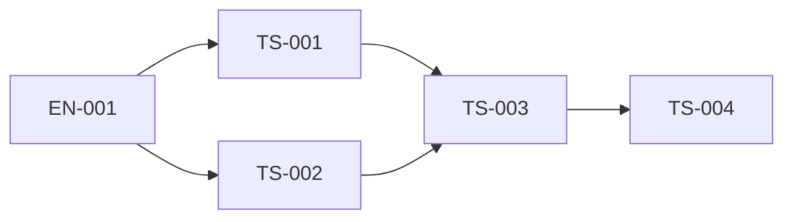

# Delivery tasks

| ID                                      | Responsibility                                     | Depends on     | Owner       | Status   |
| --------------------------------------- | -------------------------------------------------- | -------------- | ----------- | -------- |
| [EN-001](EN-001-content-scaffold.md)    | Generate and wire three content libraries          | none           | Coordinator | complete |
| [TS-001](TS-001-delivery-ui.md)         | Exact localized UI and component tests             | EN-001         | UI agent    | complete |
| [TS-002](TS-002-delivery-seo.md)        | Domain metadata and unit tests                     | EN-001         | SEO agent   | complete |
| [TS-003](TS-003-page-integration.md)    | Feature, thin route, sitemap and integration       | TS-001, TS-002 | Coordinator | complete |
| [TS-004](TS-004-documentation-audit.md) | Documentation, integrated audit and final evidence | TS-003         | Coordinator | complete |

One owner per path; shared aliases, feature/spec indices, route and sitemap belong to the coordinator. UI and SEO work independently after EN-001. No commits or generated snapshots of unrelated changes.

## Checks

Use verified inferred Nx targets `npx nx run site-content-ui:vite:test -- --run`, `site-content-seo` and `site-content-feature`. If Nx stalls as observed earlier in this chat, run the corresponding `node node_modules/vitest/vitest.mjs run --config libs/site/content/<layer>/vite.config.mts`; record the exact actual command and result. Run tests appropriate to the changed layer without broad suites. Record Red, Green, structural refactor and final regression in task evidence; infrastructure failures are not Red.

Integration gates: `npm run architecture:boundaries` and `npm run docs:check`. Add narrow app typecheck only for route/metadata integration risks. No full build/browser/manual/E2E run without the separate authorization required by repository rules.

## Post-implementation audit

- [TS-005 — Architecture audit fixes](TS-005-architecture-audit.md): AF-001 verified; explicitly requested audit and fixes, no new product behavior.
