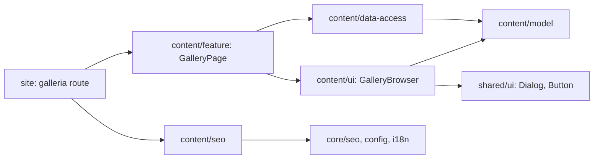

# Frontend: baseline и план файлов

Источники: [модули сайта](../../../../../architecture/site/structure/modules.md), [delivery](../../../../../standards/shared/delivery-rules.md), [тестирование](../../../../../standards/shared/testing-rules.md), [visual](visual.md), [Next.js](nextjs.md).

## Проверенный baseline перед реализацией, 2026-11-03

| Область         | Фактическое основание                                                                                      | Решение / предпосылка                                                                                                                                                              |
| --------------- | ---------------------------------------------------------------------------------------------------------- | ---------------------------------------------------------------------------------------------------------------------------------------------------------------------------------- |
| Nx и aliases    | project.json в content/{model,data-access,ui,seo,feature}, tsconfig.base.json                              | Все пять проектов/aliases существуют. scope:site, domain:content; соответствующие type:model/data-access/ui/util/feature. Новые проекты/aliases не нужны.                          |
| Границы         | eslint.config.cjs; tools/architecture/project-boundary-rules.mjs                                           | app → feature/seo; feature → content layers/core; ui → model/shared UI; data-access → model; SEO → только core config/i18n/seo. Только public index. Новых cross-domain edges нет. |
| Источник        | content/data-access/src/lib/articles-source.ts, articles.ts и README.md                                    | Ближайший пример immutable server-only source. Галерея получает отдельный manifest, статьи/их изображения не переносятся. EN-001.                                                  |
| Оболочка        | site-shell.tsx, locale layout, site-navigation.ts                                                          | Уже есть /galleria, main#content, тема, язык, Organization. Сохраняются, второй main не добавляется.                                                                               |
| UI primitives   | shared/ui/src/index.ts и lib/sheet.tsx, components.json                                                    | Button/Sheet/cn есть; центрального Dialog export нет. Sheet не переписывать под viewer. EN-002 добавляет primitive.                                                                |
| SEO             | contacts-metadata.ts, contacts-json-ld.ts, content-sitemap.ts                                              | Тот же core builder и additive descriptor. SEO не импортирует content/model/data-access из-за действующего allowlist.                                                              |
| Тесты           | content project.json/vite.config.mts, nx.json; site/project.json                                           | Vitest/RTL/jsdom, inferred vite:test; site:typecheck существует. Новый harness не нужен.                                                                                           |
| Значимые пакеты | package-lock.json: Next 16.4.3; package.json: React 19.3.0, radix-ui 1.8.1; Sheet уже импортирует radix-ui | Существующий стек, без package/lock изменений. Перед реализацией перечитать только нужные installed Next guides, если версия изменилась.                                           |

Это локальная проверка непосредственных зависимостей, не полный аудит и не запуск Nx graph/build. Подтверждённых нарушений AF-* в этой цепочке не обнаружено. EN-001 — нехватка контента, EN-002 — отсутствующий primitive, а не искусственные architecture findings.

## Владельцы и поток

`GalleryPage` на сервере получает locale, словарь и локализованные данные, выводит breadcrumb/H1, GalleryBrowser, noscript-остаток и BreadcrumbList. GalleryBrowser — наименьший связный client island для общей коллекции: фильтр, порция и выбранный media ID. Страница, shell и SEO остаются server-owned.

Карточки и grid — presentation children внутри browser; image leaf владеет загрузкой/ошибкой. Viewer отдельно от карточек: Dialog, навигация, полное фото либо iframe. Контроллер не выполняет HTTP и не импортирует source. Клиент получает только сериализуемую модель выбранного языка, без bilingual source/provenance.

## Планируемая карта

Все пути относительны к kedr-web. Planned — будущий файл, не существующая реализация. Один каталог gallery объединяет связанную UI-область, отдельные роли не складываются в page.tsx.

| Путь                                                                           | Статус             | Ответственность                                          | Задача         |
| ------------------------------------------------------------------------------ | ------------------ | -------------------------------------------------------- | -------------- |
| libs/site/content/model/src/lib/gallery/gallery-types.ts                       | planned            | Public media union и filter                              | TS-001         |
| libs/site/content/model/src/lib/gallery/gallery-dictionary.ts                  | planned            | UK/RU UI copy                                            | TS-001         |
| libs/site/content/model/src/lib/gallery/gallery-filter.ts                      | planned            | Чистые порядок/фильтр/порции                             | TS-001         |
| libs/site/content/model/src/lib/gallery/gallery.spec.ts                        | planned            | Чистые поведенческие проверки                            | TS-001         |
| libs/site/content/data-access/src/lib/gallery-source.ts                        | planned            | Подтверждённый server-only source                        | TS-002         |
| libs/site/content/data-access/src/lib/gallery.ts                               | planned            | Валидация и locale mapping                               | TS-002         |
| libs/site/content/data-access/src/lib/gallery.spec.ts                          | planned            | Integrity source и локали                                | TS-002         |
| apps/site/public/images/gallery/                                               | planned            | Реальные фото/постеры с размерами                        | EN-001, TS-002 |
| libs/site/shared/ui/src/lib/dialog.tsx                                         | planned            | Общий shadcn/Radix Dialog                                | EN-002         |
| libs/site/shared/ui/src/lib/dialog.spec.tsx                                    | planned            | Focus/close contract primitive                           | EN-002         |
| libs/site/content/ui/src/lib/gallery/gallery-header.tsx                        | planned            | Breadcrumb, H1, intro                                    | TS-003         |
| libs/site/content/ui/src/lib/gallery/gallery-browser.tsx                       | planned            | Filter/portion/active media control                      | TS-003, TS-004 |
| libs/site/content/ui/src/lib/gallery/gallery-filters.tsx                       | planned            | Доступный выбор формата                                  | TS-003         |
| libs/site/content/ui/src/lib/gallery/gallery-grid.tsx                          | planned            | Featured/grid без дублей                                 | TS-003         |
| libs/site/content/ui/src/lib/gallery/gallery-card.tsx                          | planned            | Preview/format/title/native href                         | TS-003         |
| libs/site/content/ui/src/lib/gallery/media-image.tsx                           | planned            | Loading/error/retry изображения                          | TS-003         |
| libs/site/content/ui/src/lib/gallery/gallery-browser.spec.tsx                  | planned            | Filter, portions, empty, image states                    | TS-003         |
| libs/site/content/ui/src/lib/gallery/media-viewer.tsx                          | planned            | Dialog и навигация коллекции                             | TS-004         |
| libs/site/content/ui/src/lib/gallery/video-frame.tsx                           | planned            | Provider URL/iframe lifecycle/fallback                   | TS-004         |
| libs/site/content/ui/src/lib/gallery/media-viewer.spec.tsx                     | planned            | Открытие, клавиатура, видео, cleanup                     | TS-004         |
| libs/site/content/seo/src/lib/gallery-metadata.ts и gallery-metadata.spec.ts   | planned            | Page metadata                                            | TS-005         |
| libs/site/content/seo/src/lib/gallery-json-ld.ts и gallery-json-ld.spec.ts     | planned            | BreadcrumbList                                           | TS-005         |
| libs/site/content/feature/src/lib/gallery-page.tsx и gallery-page.spec.tsx     | planned            | Server composition и HTML contract                       | TS-006         |
| apps/site/src/app/[locale]/(content)/galleria/page.tsx                         | planned            | Тонкий route и metadata export                           | TS-006         |
| libs/site/content/feature/src/lib/content-sitemap.ts и content-sitemap.spec.ts | existing, append   | Gallery descriptor без потери entries                    | TS-006         |
| libs/site/content/{model,data-access,ui,seo,feature}/src/index.ts              | existing, append   | Только нужные public exports своего слоя                 | TS-001…TS-006  |
| libs/site/shared/ui/src/index.ts                                               | existing, append   | Экспорт Dialog primitive                                 | EN-002         |
| docs/features/site/gallery.md; docs/features/README.md                         | planned / existing | Факты реализации после её завершения                     | TS-007         |
| docs/architecture/site/{structure/modules.md,platform/seo-architecture.md}     | existing, additive | Фактическая gallery boundary/URL policy после реализации | TS-007         |

## Существующие роли: сохранить / разделить

Public indexes дополняются без реорганизации. content-sitemap.ts остаётся списком descriptors. articles.ts/source, contacts/returns, Sheet, shell и locale layout сохраняют текущие роли. GalleryBrowser координирует состояние, но не содержит image error UI, provider-iframe и весь JSX диалога: они у выделенных владельцев.

Новые package/lock/alias, global.css, robots, core SEO и app sitemap не требуются. Если реализация обнаружит конкретную новую зависимость, сначала обновить план и её причину, без параллельного обхода правила.

## Проверки по риску

- Model: unit для фильтра, порядка, порций и словаря.
- Data: unit/focused source для локализации, ID, assets и недопустимых source values; без реальной сети.
- UI: component для выбора, reveal, ошибок img и keyboard/dialog lifecycle; iframe контролируемый, YouTube не вызывается.
- SEO/feature: unit и server-markup contract для head builders, sitemap и indexable content.
- Themes/responsive: source review wiring/classes относительно visual.md; это не pixel/browser evidence.
- После route — отдельный site:typecheck для Next integration. Общие suites/build/E2E/аудит не запускаются автоматически.

Команды и checkpoints принадлежат [задачам](../tasks/README.md). Во время этой документационной поставки runtime-тесты не нужны.

## Итог сверки реализации

Планируемые роли сохранены. Созданы 26 source/spec файлов, семь реальных постеров и additive public exports. Dialog получен из официального shadcn dry-run и адаптирован к текущим cn/radix-ui/tokens. Новых Nx проектов, aliases, dependency exceptions, пакетов и global CSS нет. State/image lifecycle/dialog navigation/provider lifecycle разделены. Фактическая структура — [карточка](../../../../../features/site/gallery.md). Текущий source содержит семь видео; фото отложены владельцем.

## Последующий аудит по запросу пользователя

[Аудит](../code-audit/audit.md) подтвердил границы и существующее разделение session/image/dialog/player. Новых runtime-компонентов, hooks или модулей не требуется. Смешанных независимых потоков не обнаружено; решения keep с основаниями записаны в отчёте. [TS-008](../tasks/TS-008-architecture-audit.md) добавляет gallery asset glob к inferred source-test inputs через поддерживаемый Nx24 spread, актуализирует client-island inventory и исправляет import/order Dialog. Public APIs, source, семь постеров и принятое поведение остаются прежними.
