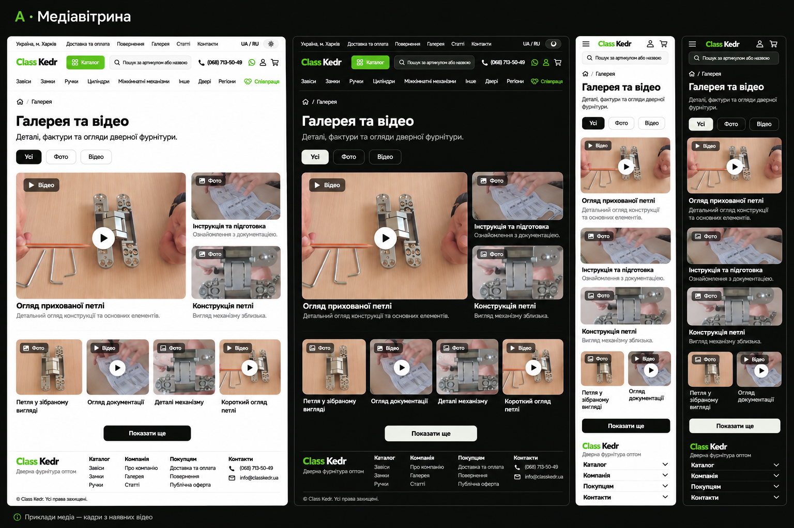

# Принятый дизайн A — «Медиавитрина»

Пользователь принял дизайн 2026-11-03. Зафиксирована рекомендованная композиция A; B/C остаются альтернативами предыдущего обсуждения.

## Композиция

1. Существующая полная шапка сайта.
2. Breadcrumb, H1 «Галерея та відео» / «Галерея и видео», одна вводная строка.
3. Кнопки формата «Усі / Фото / Відео» / «Все / Фото / Видео», active через ink/light и aria-pressed.
4. Первый материал занимает примерно две трети верхней композиции, справа до двух вторичных. Обложка, обозначение формата, затем подпись под изображением. Редакционный порядок source задаёт lead; алгоритм не объявляет материал новым или популярным.
5. Нижняя регулярная сетка, затем «Показати ще» при наличии ещё материалов; текущий футер.

При трёх и менее элементах нижняя часть и лишняя кнопка не появляются. При двух/одном верхняя композиция занимает доступную ширину; отсутствующие материалы не заполняются искусственными слотами.

## Адаптивность

Content max-width 1440px; gutter 16px, от lg — 24px. На desktop верхняя композиция 2:1, ниже до четырёх колонок. На tablet — две. На mobile крупный материал и вторичные идут в исходном порядке; компактная нижняя сетка может иметь две колонки от 360px, ниже — одну. Подписи не уменьшаются ради плотности; при переполнении колонка становится одной.

Карточки имеют стабильное соотношение сторон по формату компонента; object-cover допустим для превью без потери смысла, viewer показывает полное фото через object-contain. Видео — область 16:9 с учётом реального источника. Viewer на телефоне занимает экран и учитывает safe-area; закрытие всегда видно, горизонтального overflow нет.

## Темы и типографика

Источник точных tokens — [дизайн-система](../../../../../standards/site/design-system.md) и global.css, не пиксельный образец.

- Onest; Lucide stroke 1.75; поля/кнопки radius 8px, панели 10–16px.
- Light: #FFFFFF / #0F110F, вторичный #5C6459, border #E3E6DF.
- Dark: #0C0D0C / #EDEFEA, вторичный #9AA296, border #242823.
- Основные кнопки и active filter: ink/white в light, light/ink в dark.
- Brand #3FA435 — короткие акценты; зелёный текст #2A7323 / #7DD06F. Зелёные градиенты и зелёные описания не нужны.
- Контентный H1 следует существующему text-3xl sm:text-4xl; вертикальные секции около 28–32px.

## Взаимодействие и a11y

Карточка имеет обычный href к изображению/YouTube как fallback, доступное имя включает формат и название. После hydration нажатие открывает dialog. У видео видны и format label, и play; цвет не единственный признак формата.

Dialog: локализованный заголовок, явное закрытие, предыдущий/следующий с доступными именами, реальная позиция «N із M» / «N из M». При одном материале переходы скрыты. Focus trap/return и scroll lock принадлежат общему Radix Dialog. Стрелки при фокусе в фото/управлении переключают материалы текущей коллекции, включая видео без autoplay; внутри iframe не перехватываются. Motion уважает prefers-reduced-motion.

## Copy и состояния

| Элемент                 | UK                                                 | RU                                                 |
| ----------------------- | -------------------------------------------------- | -------------------------------------------------- |
| Intro                   | Деталі, фактури та огляди дверної фурнітури        | Детали, фактуры и обзоры дверной фурнитуры         |
| More / reset            | Показати ще / Показати все                         | Показать ещё / Показать всё                        |
| Empty photo             | Фотографій поки немає                              | Фотографий пока нет                                |
| Empty video             | Відео поки немає                                   | Видео пока нет                                     |
| Image error / retry     | Не вдалося завантажити зображення / Спробувати ще  | Не удалось загрузить изображение / Попробовать ещё |
| Close / previous / next | Закрити / Попередній матеріал / Наступний матеріал | Закрыть / Предыдущий материал / Следующий материал |
| Original / reload       | Відкрити на YouTube / Завантажити відео ще раз     | Открыть на YouTube / Загрузить видео ещё раз       |

Loading удерживает размеры; unavailable image — нейтральный panel с иконкой, подписью и повтором. Для видео original/reload доступны независимо от того, сообщает ли внешнее iframe причину отказа. Короткое live-сообщение добавленных карточек не переводит фокус произвольно.

## Границы артефакта

Растр создан встроенным imagegen на основе пользовательского референса и постеров старой галереи. Это визуальная интерпретация; его «Фото» и подписи не подтверждают production dataset. Генерированные товарные изображения из растра не извлекать в приложение.

Точные город, контакты, состав навигации, иконки и четыре footer-группы берутся из текущего shell. Для наполнения действует [content-readiness](content-readiness.md). Принятие концепта не заменяет content gate.
