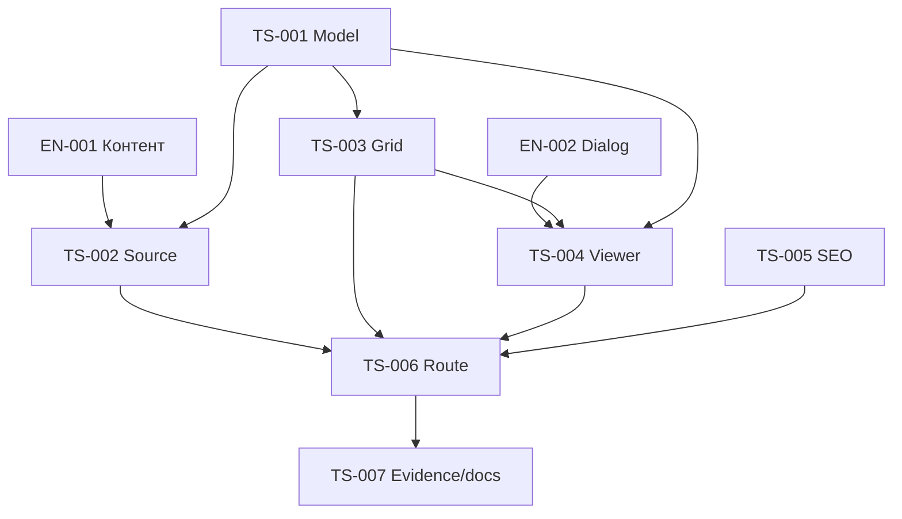

# План реализации

Согласованный первый видеоэтап реализован. Все 7 публичных роликов перенесены; фотографии отложены владельцем.

| ID                                            | Ответственность                                         | Depends on                     | Текущий статус       |
| --------------------------------------------- | ------------------------------------------------------- | ------------------------------ | -------------------- |
| [EN-001](enablers/EN-001-confirm-media.md)    | Подтвердить production контент                          | —                              | verified video stage |
| [EN-002](enablers/EN-002-dialog-primitive.md) | Общий Dialog primitive                                  | —                              | completed            |
| [TS-001](TS-001-gallery-model.md)             | Модель, словарь и чистые операции галереи               | нет                            | completed            |
| [TS-002](TS-002-gallery-source.md)            | Подтверждённый server-only источник                     | TS-001, EN-001                 | completed            |
| [TS-003](TS-003-media-grid.md)                | Медиакомпозиция, фильтры и состояния изображений        | TS-001                         | completed            |
| [TS-004](TS-004-media-viewer.md)              | Доступный просмотр фото и видео                         | TS-001, TS-003, EN-002         | completed            |
| [TS-005](TS-005-gallery-seo.md)               | Metadata и BreadcrumbList                               | нет                            | completed            |
| [TS-006](TS-006-gallery-route.md)             | Серверная страница, тонкий route и sitemap              | TS-002, TS-003, TS-004, TS-005 | completed            |
| [TS-007](TS-007-verification-docs.md)         | Проверка поставки и фактическая документация            | EN-001, EN-002, TS-001…TS-006  | completed            |
| [TS-008](TS-008-architecture-audit.md)        | Запрошенный аудит и локальные исправления AF-001…AF-003 | TS-007                         | completed / verified |

## Зависимости и границы параллельной работы

Первый независимый набор: EN-002, TS-001 и TS-005; EN-001 подтверждён для видеоэтапа. После TS-001 доступна TS-003 на fixtures, а TS-002 получил семь видео. TS-004 продолжает GalleryBrowser, поэтому не редактирует его одновременно с TS-003. Публичные indexes дополняются последовательно с сохранением текущих чужих изменений.

Каждый task описывает свою focused команду и evidence. Это не поручение запускать все targets, build, HTTP или browser. TS-007 проверяет актуальность доказательств и только остаточные риски; полный audit не добавляется. После каждого кода — узкая проверка роли файлов до следующего слоя.

## Контрольные точки

- Source недоступен — TS-002 и TS-006 не ready, а полная поставка не complete.
- Primitive отсутствует — TS-004 ждёт EN-002.
- Только после TS-006 карточка и catalog могут описывать фактическую галерею.
- Полная матрица [SC → tasks → tests](../traceability.md) не заменяет detailed Evidence в task-файлах.

## Результат

EN-002 и TS-001…TS-007 завершены для текущего этапа; блокирующих prerequisites нет. Фото — следующий согласованный этап. 112 focused cases, application types и scoped spec types прошли; live HTTP/browser/player/CWV/build не проверялись.

По отдельному запросу пользователя выполнен [аудит архитектуры](../code-audit/audit.md): TS-008 завершён, все три AF verified. Первоначальная история TS-001…TS-007 и состав первого видеоэтапа сохранены.
