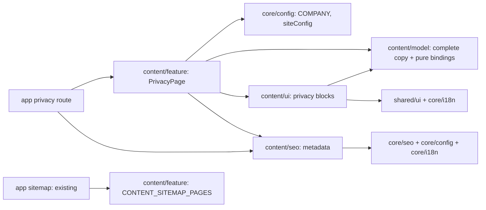

# Frontend: архитектура и ответственность

Источники: [модули и зависимости](../../../../../architecture/site/structure/modules.md), [дизайн-система](../../../../../standards/site/design-system.md), [поставка](../../../../../standards/shared/delivery-rules.md), [тестирование](../../../../../standards/shared/testing-rules.md), [returns pattern](../../../../../features/site/returns-exchanges.md).

## Проверенный архитектурный базис

| Область                 | Фактический источник                                       | Применимое правило и целевое решение                                                                          | AF / prerequisite      |
| ----------------------- | ---------------------------------------------------------- | ------------------------------------------------------------------------------------------------------------- | ---------------------- |
| Проекты                 | project.json content/model, ui, seo, feature               | Все существуют; scope:site, domain:content; типы model/ui/util/feature соответственно                         | Новые проекты не нужны |
| Разрешённые зависимости | modules.md и tools/architecture/project-boundary-rules.mjs | app → feature/seo; feature → model/ui/seo + core; UI → model/core/shared; SEO → только core/config, i18n, seo | Исключений нет         |
| Public APIs             | Четыре src/index.ts и aliases tsconfig.base.json           | Только @site/content/* и core/shared public APIs; новые exports добавляются адресно                           | EN-001                 |
| Состояние/данные        | ReturnsPage и native returns FAQ                           | Server composition; typed local copy; native details/hash; без page client island                             | Нет нового data-access |
| Конфигурация            | core/config COMPANY и siteConfig                           | Feature получает origin/контакты и передаёт явные bindings чистой модели                                      | EN-001                 |
| Тесты                   | content/{model,ui,seo,feature}/vite.config.mts             | Vitest; unit, component и server markup; exact focused commands в задачах                                     | Harness уже есть       |
| Версии                  | package-lock.json                                          | Next 16.4.3; React 19.3.0; Tailwind 4.3.3; Vitest 5.0.5; @nx/next и @nx/vite 24.0.3                           | Новых пакетов нет      |

Это локальное сопоставление затронутой области с правилами, не полный аудит. Подтверждённых системных нарушений или AF-блокеров для этой фичи нет. Изменения других страниц в рабочем дереве не входят в scope.

## Поток

Angular translation — только источник миграции. Ни runtime import Storefront/Transloco, ни чтение legacy source из shipped приложения не допускаются. Не использовать существующий article data-access для статической политики.

## Решения оставить / разделить

| Существующий файл/модуль                   | Решение                                                                                                    |
| ------------------------------------------ | ---------------------------------------------------------------------------------------------------------- |
| returns-page.tsx и ui/returns/*            | Оставить; это ближайшие patterns, общую абстракцию двух страниц не вводить                                 |
| content/feature/src/lib/content-sitemap.ts | Оставить владельцем списка; добавить один descriptor, сохранить все текущие entries                        |
| content/*/src/index.ts                     | Оставить публичными входами; только новые privacy exports                                                  |
| app sitemap.ts                             | Оставить: уже потребляет общий список; новый sitemap provider не нужен                                     |
| core shell, config, i18n и shared/ui       | Переиспользовать текущие API и tokens без правок                                                           |
| Новая privacy UI                           | Композиция, навигация, полный документ и контакт имеют отдельных владельцев; raw copy не смешивается с JSX |

## Планируемая карта файлов

Все пути относительно репозитория. Существующие проекты/aliases не генерируются заново.

| Путь                                                                                                                      | Статус                       | Одна ответственность                                     | Задача        |
| ------------------------------------------------------------------------------------------------------------------------- | ---------------------------- | -------------------------------------------------------- | ------------- |
| apps/site/src/app/[locale]/(content)/privacy-policy/page.tsx                                                              | planned                      | Await params, locale guard, feature и metadata           | TS-004        |
| libs/site/content/model/src/lib/privacy-types.ts                                                                          | planned                      | Typed view contract и stable section IDs                 | TS-001        |
| libs/site/content/model/src/lib/privacy-policy-copy.ts                                                                    | planned                      | Полная UK/RU source copy с provenance                    | TS-001        |
| libs/site/content/model/src/lib/privacy-policy-sections.ts                                                                | planned                      | Ordered source-key mapping и разрешённые bindings        | TS-001        |
| libs/site/content/model/src/lib/privacy-dictionary.ts                                                                     | planned                      | UI summary/labels и сборка dictionary                    | TS-001        |
| libs/site/content/model/src/lib/privacy-policy-sections.spec.ts                                                           | planned                      | Полнота/порядок и config substitutions                   | TS-001        |
| libs/site/content/ui/src/lib/privacy/privacy-content.tsx                                                                  | planned                      | Responsive composition и общий корень hash CSS           | TS-002        |
| libs/site/content/ui/src/lib/privacy/privacy-header.tsx                                                                   | planned                      | Крошки, H1, вступление                                   | TS-002        |
| libs/site/content/ui/src/lib/privacy/privacy-summary.tsx                                                                  | planned                      | Три пункта summary                                       | TS-002        |
| libs/site/content/ui/src/lib/privacy/privacy-navigation.tsx                                                               | planned                      | Одна link-list, desktop nav и mobile details             | TS-002        |
| libs/site/content/ui/src/lib/privacy/privacy-policy.tsx                                                                   | planned                      | Полные ordered sections и семантические блоки            | TS-002        |
| libs/site/content/ui/src/lib/privacy/privacy-contact.tsx                                                                  | planned                      | Mailto CTA, configured contact и related offer link      | TS-002        |
| libs/site/content/ui/src/lib/privacy/privacy-content.module.css                                                           | planned                      | Только scoped fragment-selected styling                  | TS-002        |
| libs/site/content/ui/src/lib/privacy/privacy-content.spec.tsx                                                             | planned                      | Locales, anchors, disclosure, contacts и server markup   | TS-002        |
| libs/site/content/feature/src/lib/privacy-page.tsx                                                                        | planned, implemented         | Server config→dictionary→UI и page BreadcrumbList        | TS-004        |
| libs/site/content/feature/src/lib/privacy-page.spec.tsx                                                                   | added during implementation  | Реальный server markup и совпадение graph/крошек         | TS-004        |
| libs/site/content/seo/src/lib/privacy-metadata.ts                                                                         | planned                      | Metadata через core builder                              | TS-003        |
| libs/site/content/seo/src/lib/privacy-metadata.spec.ts                                                                    | planned                      | Canonical, alternates, titles, robots                    | TS-003        |
| libs/site/content/seo/src/lib/privacy-json-ld.ts                                                                          | planned                      | BreadcrumbList, согласованный с видимыми крошками        | TS-003        |
| libs/site/content/seo/src/lib/privacy-json-ld.spec.ts                                                                     | planned                      | Структура, локаль и origin breadcrumbs                   | TS-003        |
| libs/site/content/feature/src/lib/content-sitemap.ts и content-sitemap.spec.ts                                            | existing, append             | Публикация нового URL в существующем sitemap contract    | TS-004        |
| libs/site/content/{model,ui,seo,feature}/src/index.ts                                                                     | existing, append             | Публичные exports privacy                                | TS-001…TS-004 |
| docs/features/site/privacy-policy.md                                                                                      | planned after implementation | Фактическая feature card с Mermaid, tree и focused tests | TS-005        |
| docs/features/README.md, docs/architecture/site/structure/modules.md, docs/architecture/site/platform/seo-architecture.md | existing                     | Реальные route/module facts после реализации             | TS-005        |
| docs/specs/README.md и текущая СДД                                                                                        | existing                     | Статусы и evidence                                       | TS-005        |

## Данные, состояние, доступность

Модель чистая; feature связывает её с COMPANY/siteConfig. Политика рендерит строки/типизированные блоки, не raw HTML. UI остаётся server component; native details и CSS fragment styling достаточны. Client store, effects, observers и запросы не добавляются.

Стабильные id одинаковы для языков; TOC и разделы строятся из одного массива. Оформление и состояния описаны в [visual.md](visual.md). Полный текст всегда вне details. Навигация и крошки получают понятные accessible names, decorative icons — aria-hidden, заголовки последовательно H1/H2. Focus не заменяется подсветкой выбранного fragment.

Loading/empty/API error/offline retry/permission states неприменимы: локальные compile-time данные и существующие shell controls. Ошибка целостности copy выявляется тестом/сборкой, а не пустой опубликованной политикой.

## План проверки

Model unit — потери исходных пунктов и hardcode. Component/server-render — оба языка, TOC targets, native раскрытие, полный HTML, mailto/tel/offer. SEO unit — адреса/alternates/gate/BreadcrumbList; sitemap unit — добавление без потери соседних страниц. Source review — tokens, responsive wiring, CSS :has fallback и scroll offsets.

После изменения каждого слоя проверить ответственность затронутых файлов. Разделять независимые роли, не вводить shared abstraction или новые библиотеки ради размера файлов. Browser/manual/visual/E2E/build — только после отдельного явного разрешения; текущая задача их не выполняет.

## Результат реализации 2026-11-03

Карта исполнена в существующих проектах. Единственное уточнение — новый focused feature SSR test для реального связывания config/UI/graph; роли source файлов не расширялись. [Фактическая структура и команды](../../../../../features/site/privacy-policy.md), [локальный review](../verification/local-review.md). 39 focused tests и direct typegen/tsc passed; browser/HTTP/build unrun.
