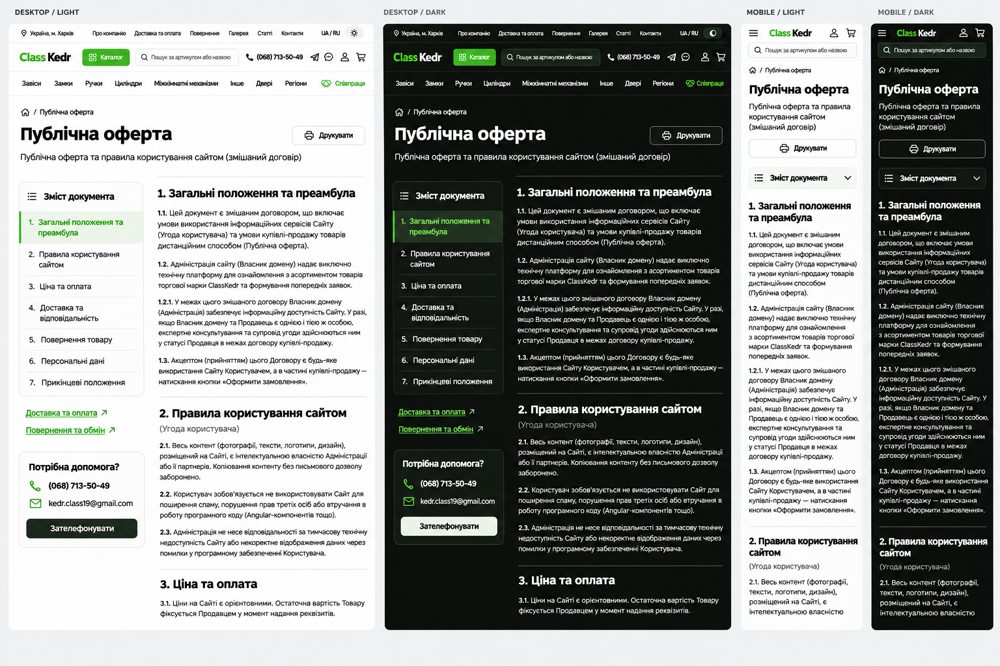

# Accepted visual concept

Accepted by the owner in this chat on 2026-11-03, followed by a request for SDD documentation. This records the concept-acceptance stage. The owner subsequently authorized implementation of the accepted SDD; the current implementation status is in the feature README.

- Desktop: seven-item contents rail at left, readable contract column at right, related delivery/returns links and configured contact panel below contents.
- Mobile/tablet: collapsed native contents above a fully open document; contact panel after the full document.
- Short H1, original full document name and an outlined print action.
- Onest, neutral surfaces, thin borders, green navigation accents; use current site tokens and shell rather than copying a header from this bitmap.
- The screenshot is an upper-page excerpt. All remaining source paragraphs and the final source note continue below it; the existing site footer follows.

[Exact imagegen prompt](public-offer-image-prompt.txt). The builtin imagegen tool produced the image from the owner's attached returns-page reference. Text in the bitmap is illustrative; [the frozen source](source-baseline.json) and current source dictionary govern contract fidelity.

## Responsive contract

At `lg` (1024px) and wider use a left rail around 16–18rem and a flexible document column capped near 75 characters; the outer shell remains capped at 90rem. Below `lg`, use one column and native contents disclosure. Check source/styles for 360px and 390px phones, 768px tablet and 1440px desktop; these are acceptance widths, not permission to run a browser.

Use existing 16px gutters, 24px from `lg`. Reading text is at least 16px with relaxed line height. H1 follows the accepted 32px phone / 48px desktop hierarchy; headings and contents labels wrap naturally. No fixed page height, cropped legal copy or bitmap content is shipped.
