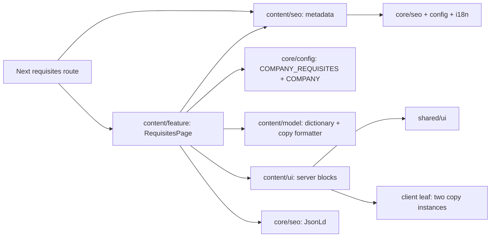

# Frontend: baseline и план реализации

Правила: [site modules](../../../../../architecture/site/structure/modules.md), [design system](../../../../../standards/site/design-system.md), [delivery](../../../../../standards/shared/delivery-rules.md), [testing](../../../../../standards/shared/testing-rules.md). Это локальная проверка непосредственной цепочки, не полный аудит.

## Baseline до реализации, проверен 2026-11-03

| Область                 | Проверенный источник                                                                      | Решение / отличие от baseline                                                                                       |
| ----------------------- | ----------------------------------------------------------------------------------------- | ------------------------------------------------------------------------------------------------------------------- |
| Content-проекты         | libs/site/content/{model,ui,seo,feature}/project.json                                     | Уже существуют scope:site, domain:content и type:model/ui/util/feature соответственно; новых проектов нет           |
| Core/shared             | core/config и i18n: type:util; core/seo: type:core; shell: type:shell; shared/ui: type:ui | Все shared-scoped проекты и public aliases существуют                                                               |
| Aliases / публичный API | tsconfig.base.json; src/index.ts каждой библиотеки                                        | Импорт через @site/content/* и @site/core/*; exports дополняются без потери соседних                                |
| Constraints             | eslint.config.cjs; tools/architecture/project-boundary-rules.mjs:16–26                    | content/seo может импортировать только core/config, core/i18n, core/seo; dictionary из model туда не переносится    |
| Данные компании         | core/config/src/lib/company.ts                                                            | Контакты уже есть; официальных реквизитов нет. Отдельный источник создаётся после EN-001                            |
| Server composition      | content/feature/src/lib/contacts-page.tsx и contacts route                                | Reuse архитектурного подхода; contacts-код не рефакторится                                                          |
| Clipboard               | content/ui/src/lib/contacts/contacts-copy-phone-button.tsx                                | Сохраняем поведение; новый узкий leaf для произвольного payload без зависимости ui → shell                          |
| Main и shell            | core/shell/src/lib/site-shell.tsx; locale layout                                          | Единственный main#content, skip-link, тема и locale у shell/layout; Organization у locale layout, WebSite у главной |
| Навигация               | core/shell/src/lib/navigation/site-navigation.ts                                          | Requisites legal link уже есть; оферта/политика — существующие targets без Next pages, EN-002                       |
| Sitemap                 | content/feature/src/lib/content-sitemap.ts; app/sitemap.ts                                | Расширить descriptor registry, сохранить свежие articles и другие изменения; app builder оставить                   |
| Harness                 | content vite.config.mts; nx.json @nx/vite plugin                                          | Vitest/RTL/jsdom и inferred vite:test существуют; новый harness не нужен                                            |
| Next.js                 | package-lock.json и node_modules/next/package.json                                        | 16.4.3; Cache Components включён; route params async                                                                |
| UI stack                | shared/ui; global.css; locale fonts                                                       | Existing shadcn/Radix + Tailwind v4, Onest, JetBrains Mono, Lucide; новых packages нет                              |

Реализация выполнена в этих границах. Источник COMPANY_REQUISITES создан после EN-001; model/SEO/UI/feature exports дополнены без удаления соседних. Public-offer route появился отдельно; EN-002 остаётся открытым для полного набора legal destinations.

Направления: app → content/feature, content/seo; feature → content/model, ui, seo и core/config/i18n/seo; ui → content/model, shared/ui и допустимые core utilities; model не импортирует config/React/browser state для formatter; seo следует своему узкому allowlist. Config не импортирует content/model.

Подтверждённых архитектурных AF в этой цепочке нет. EN-001/EN-002 — зависимости фактов и смежных материалов, а не искусственные архитектурные findings.

## Владельцы и поток данных

Стрелки — планируемые зависимости; это не диаграмма уже реализованной страницы. Feature собирает сериализуемые props и payload. UI не читает banking config напрямую; copy leaf получает только текст и labels.

## Проверка существующих ответственностей

| Файл                                       | Фактическая роль                           | Решение                                                         |
| ------------------------------------------ | ------------------------------------------ | --------------------------------------------------------------- |
| core/config/src/lib/company.ts             | Общие публичные контакты                   | Оставить; банковские факты в отдельный company-requisites.ts    |
| core/config/src/index.ts                   | Public config API                          | Добавить export после EN-001; не смешивать с formatter          |
| content/*/src/index.ts                     | Публичные точки входа существующих страниц | Дополнить, сохранить returns/contacts/articles и внешние правки |
| content/feature/src/lib/content-sitemap.ts | Реестр locale-free descriptors             | Только добавить /requisites; не пересобирать от старой копии    |
| contacts-copy-phone-button.tsx             | Phone clipboard со своим feedback          | Оставить; извлечение общего примитива не требуется этим объёмом |
| site-navigation.ts, footer                 | Существующие ссылки                        | Оставить: новый route активирует уже имеющийся пункт            |
| app/sitemap.ts, next.config.ts             | Общая сборка/redirect policy               | Оставить: нового redirect или sitemap adapter нет               |

## Карта будущих файлов

Все пути относительны к `E:\RiderProjects\kedr-web`. Таблица сохраняет принятый план; он сопоставлен с фактической структурой после реализации. Все in-scope пути созданы/дополнены по своим ролям; текущая actual tree и Tests находятся в [карточке функции](../../../../../features/site/requisites.md).

| Точный путь                                                             | Статус                                 | Ответственность                                | Задача         |
| ----------------------------------------------------------------------- | -------------------------------------- | ---------------------------------------------- | -------------- |
| libs/site/core/config/src/lib/company-requisites.ts                     | planned после EN-001                   | Подтверждённые официальные факты               | TS-005         |
| libs/site/core/config/src/index.ts                                      | existing, append                       | Экспорт COMPANY_REQUISITES                     | TS-005         |
| libs/site/content/model/src/lib/requisites-types.ts                     | planned                                | Presentation contracts                         | TS-001         |
| libs/site/content/model/src/lib/requisites-dictionary.ts                | planned                                | UK/RU интерфейсный copy                        | TS-001         |
| libs/site/content/model/src/lib/requisites-copy.ts                      | planned                                | Pure payload formatter                         | TS-001         |
| libs/site/content/model/src/lib/requisites-copy.spec.ts                 | planned                                | Точность/порядок payload                       | TS-001         |
| libs/site/content/model/src/index.ts                                    | existing, append                       | Public model API                               | TS-001         |
| libs/site/content/ui/src/lib/requisites/requisites-content.tsx          | planned                                | Server composition и layout                    | TS-003         |
| libs/site/content/ui/src/lib/requisites/requisites-header.tsx           | planned                                | Breadcrumb, H1, intro, anchors                 | TS-003         |
| libs/site/content/ui/src/lib/requisites/requisites-administration.tsx   | planned                                | Данные администрации                           | TS-003         |
| libs/site/content/ui/src/lib/requisites/requisites-bank.tsx             | planned                                | Банк, IBAN, включение copy actions             | TS-003         |
| libs/site/content/ui/src/lib/requisites/requisites-payment.tsx          | planned                                | Пояснение перед оплатой                        | TS-003         |
| libs/site/content/ui/src/lib/requisites/requisites-support.tsx          | existing, audit extraction             | Support layout/composition                     | TS-003, TS-008 |
| libs/site/content/ui/src/lib/requisites/requisites-legal-links.tsx      | existing, audit extraction             | Legal navigation with narrow props             | TS-008         |
| libs/site/content/ui/src/lib/requisites/requisites-contact-card.tsx     | existing, audit extraction             | Manager phone/call presentation                | TS-008         |
| libs/site/content/ui/src/lib/requisites/requisites-content.spec.tsx     | planned                                | Локали, сведения, назначения ссылок, semantics | TS-003         |
| libs/site/content/ui/src/lib/requisites/requisites-copy-button.tsx      | planned                                | Clipboard adapter и local state                | TS-002         |
| libs/site/content/ui/src/lib/requisites/requisites-copy-button.spec.tsx | planned                                | Pending/success/error/unavailable/retry        | TS-002         |
| libs/site/content/ui/src/index.ts                                       | existing, append                       | Экспорт только RequisitesContent               | TS-003         |
| libs/site/content/seo/src/lib/requisites-metadata.ts                    | planned                                | Localized metadata builder                     | TS-004         |
| libs/site/content/seo/src/lib/requisites-metadata.spec.ts               | planned                                | Canonical/alternates/indexing                  | TS-004         |
| libs/site/content/seo/src/lib/requisites-json-ld.ts                     | planned                                | Absolute BreadcrumbList                        | TS-004         |
| libs/site/content/seo/src/lib/requisites-json-ld.spec.ts                | planned                                | Видимый путь и schema shape                    | TS-004         |
| libs/site/content/seo/src/index.ts                                      | existing, append                       | Public SEO builders                            | TS-004         |
| libs/site/content/feature/src/lib/requisites-page.tsx                   | planned                                | Config/model/UI/JSON-LD composition            | TS-005         |
| libs/site/content/feature/src/lib/requisites-page.spec.tsx              | planned                                | Server integration                             | TS-005         |
| libs/site/content/feature/src/index.ts                                  | existing, append                       | Экспорт RequisitesPage                         | TS-005         |
| apps/site/src/app/[locale]/(content)/requisites/page.tsx                | planned                                | Thin locale route/metadata delegation          | TS-005         |
| libs/site/content/feature/src/lib/content-sitemap.ts                    | existing, append                       | Descriptor /requisites                         | TS-006         |
| libs/site/content/feature/src/lib/content-sitemap.spec.ts               | existing, extend                       | Уникальность двух URL и сохранение registry    | TS-006         |
| docs/features/site/requisites.md                                        | planned при реализации                 | Фактическая архитектура и Tests                | TS-007         |
| docs/features/README.md                                                 | existing, append при реализации        | Строка реализованной функции                   | TS-007         |
| docs/architecture/site/platform/seo-architecture.md                     | existing, scoped update при реализации | Отражение внедрённого content URL              | TS-007         |
| docs/architecture/site/structure/modules.md                             | existing, scoped update при реализации | Фактический entry/source если нужен            | TS-007         |
| docs/specs/README.md и текущая SDD                                      | existing, update                       | Статус и evidence                              | TS-007         |

## State, UI и адаптивность

Только copy-state локален клиенту: idle → pending → success/error; экземпляры независимы, повтор при pending запрещён. Нет Redux/query cache/localStorage/Server Actions. Clipboard write вызывается по явному действию; чтение clipboard и eager permission запросы не нужны. При отказе остаётся выделяемый исходный текст; нет deprecated execCommand fallback.

Server UI использует существующие Button/cn и tokens. В light primary ink, в dark off-white; ссылки brand-text. Контент до 1440 px; gutters 16/24 px; панели md:grid-cols-2, gap 16/24 px; на mobile одна колонка, длинные строки breakable, IBAN отдельно от copy hit-area. Тексты и точные темы — в visual.md.

Заголовки, dl/dt/dd, accessible labels, статус aria-live, focus и selectable payload проверяются компонентно. Геометрию и contrast реального render эти тесты не доказывают; browser-проверка требует отдельного разрешения.

## Минимальные проверки будущей реализации

| Риск                                                            | Проверка                                              |
| --------------------------------------------------------------- | ----------------------------------------------------- |
| Изменение идентификаторов при копировании                       | Unit formatter, сравнение raw строки                  |
| Повтор/отказ browser adapter                                    | Component clipboard tests с controlled Promise        |
| Локали/anchors/phone/legal links                                | Component server-совместимого content                 |
| Ошибка передачи фактов/дублирование main или Organization       | Server integration RequisitesPage                     |
| Canonical/hreflang/indexing/JSON-LD                             | SEO unit builders                                     |
| Потеря соседних sitemap entries                                 | Focused sitemap integration                           |
| Thin Next route/locale params                                   | Source check и узкий site:typecheck при необходимости |
| Актуальность реквизитов / фактическое существование legal pages | EN-001/EN-002, не заменяются mocks                    |

Точные scoped команды и evidence находятся в задачах. Model не получает вымышленный inferred lint target; при необходимости использовать прямой ESLint только для затронутых model-файлов. Broad suites, build, HTTP/browser/visual/manual/E2E не являются автоматическим пакетом проверок.

Архитектурный [аудит](../code-audit/audit.md) после внедрения изменил только внутреннюю декомпозицию Support. Его внешний API и прочие owners сохранены; actual tree отражена в feature card.
