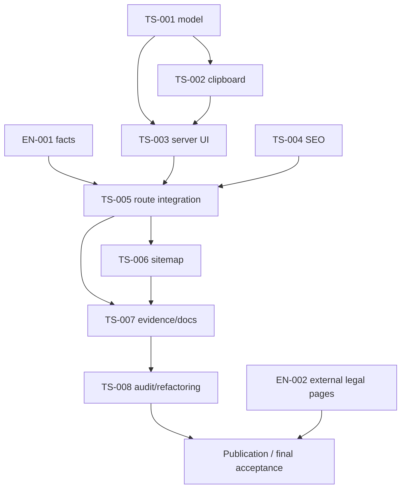

# Граф задач

Реализация разрешена пользователем 2026-11-03. TS-001…TS-008 — verified на локальных границах, EN-001 — verified. EN-002 — open перед публикацией; локальный TS-007 завершён с явным release gate.

| ID                                              | Ответственность                                    | Depends on                    | Covers / Enables                                    |
| ----------------------------------------------- | -------------------------------------------------- | ----------------------------- | --------------------------------------------------- |
| [EN-001](enablers/EN-001-confirm-requisites.md) | Подтвердить production-факты                       | Нет; решение владельца        | SC-001…SC-003, SC-006…SC-007, SC-011                |
| [EN-002](enablers/EN-002-legal-destinations.md) | Готовность внешних юридических destinations        | Отдельный перенос legal pages | SC-012; финальная поставка                          |
| [TS-001](TS-001-model-copy.md)                  | Presentation model, dictionary, payload            | Нет                           | SC-002…SC-003, SC-006…SC-007                        |
| [TS-002](TS-002-clipboard.md)                   | Browser clipboard leaf                             | TS-001                        | SC-005…SC-010                                       |
| [TS-003](TS-003-server-ui.md)                   | Принятые server UI-блоки                           | TS-001, TS-002                | SC-001…SC-005, SC-011…SC-012                        |
| [TS-004](TS-004-seo.md)                         | Metadata и BreadcrumbList                          | Нет                           | SC-013…SC-014                                       |
| [TS-005](TS-005-route-integration.md)           | Подтверждённый источник и server route integration | EN-001, TS-001…TS-004         | SC-001…SC-003, SC-011, SC-013…SC-014, SC-016        |
| [TS-006](TS-006-sitemap.md)                     | Включение в общий sitemap                          | TS-005                        | SC-015                                              |
| [TS-007](TS-007-verification-handoff.md)        | Сведение evidence и фактическая документация       | TS-005, TS-006                | Сведение evidence; SC-012 остаётся ограничен EN-002 |
| [TS-008](TS-008-architecture-audit.md)          | Архитектурный аудит и split Support, AF-001        | TS-007                        | SC-004, SC-005, SC-011, href SC-012                 |

## Порядок выполнения и проверки

После отдельного поручения на реализацию начинать только ready-задачи. TS-001/TS-004 можно выполнять независимо от подтверждения фактов. Контракты и тестовые fixtures не дают права публиковать snapshot-значения; production config создаётся в TS-005 после EN-001. EN-002 блокирует публикацию и полную приёмку юридических ссылок, но не локальный verification/docs handoff TS-007.

Каждый task выполняет короткую проверку ответственности затронутых файлов. Red/Green фиксируются для нового тестируемого поведения; окончательный focused regression выполняется после последнего изменения этой области, без повторов из-за документации.

Команды в задачах — выбор по риску, а не обязательный общий прогон. Тесты model/UI/SEO/feature проверяют разные boundaries; нельзя подменять ими актуальность юридических данных или реальный HTTP/head. Shared invariants/соседние функции сохраняются.

Полный audit, весь test:site, coverage, production build, запуск HTTP-сервера, browser/visual/manual/E2E — только при отдельном явном поручении. Unrun evidence остаётся unrun, а не pass.
