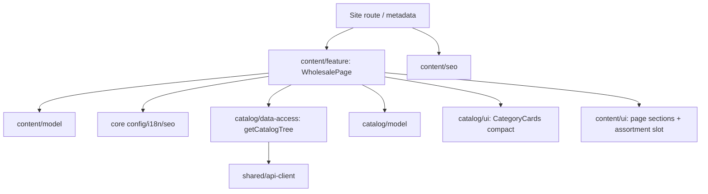

# Frontend: проверенный baseline и план

Источники: [модули](../../../../../architecture/site/structure/modules.md), [дизайн-система](../../../../../standards/site/design-system.md), [delivery](../../../../../standards/shared/delivery-rules.md), [testing](../../../../../standards/shared/testing-rules.md), актуальные карточки [contacts](../../../../../features/site/contacts.md), [catalog](../../../../../features/site/catalog.md), [home](../../../../../features/site/home.md). Общий architecture README содержит исторический shell-only статус; фактический baseline ниже проверен по прямым исходникам.

## Baseline на 2026-11-03

| Область            | Фактическое доказательство                                                                                        | Решение / предпосылка                                                                                                |
| ------------------ | ----------------------------------------------------------------------------------------------------------------- | -------------------------------------------------------------------------------------------------------------------- |
| Content слои       | `libs/site/content/{model,ui,seo,feature}/project.json`, public index                                             | Все существуют; новые библиотеки/aliases не нужны.                                                                   |
| Tags               | `scope:site`, `domain:content`; model/ui/util/feature                                                             | Сохраняются; SEO — type:util и только core config/i18n/seo.                                                          |
| Каталог            | public getCatalogTree; CatalogTreeNode/CATALOG_ROOTS/categoryPath; CategoryCards                                  | Использовать через feature; не копировать fetch, DTO, mapping, slug или фото-таблицу.                                |
| Междоменные потоки | `tools/architecture/project-boundary-rules.mjs` разрешает home-feature → catalog, но не content-feature → catalog | EN-001 разрешает ровно три project edges до новых imports.                                                           |
| Данные             | `catalog/data-access/.../catalog-loaders.ts`, cached public tree                                                  | Существующие server-only transport/cache; обычная ошибка возвращает null.                                            |
| Shell              | `site-shell.tsx`, locale layout                                                                                   | Сохранить единственный main#content, header/footer, язык/тему, Organization и skip-link.                             |
| Metadata/sitemap   | core/seo, content/seo contacts builders, content-sitemap.ts                                                       | Новые domain builders/descriptor, без изменения core/app sitemap.                                                    |
| UI                 | shared Button/cn, content sections, catalog CategoryCards                                                         | Server-only page UI; компактный variant у catalog owner, без нового client leaf.                                     |
| Версии             | root package.json / installed next package                                                                        | Next 16.4.3, React 19.3.0, Nx 24.0.3, Vitest 5.0.5. Новых пакетов нет.                                               |
| Тесты              | content/catalog-ui vite.config.mts, root scripts и текущие specs                                                  | Existing Vitest/RTL/jsdom + Nx inferred vite:test. Targets проверять перед выполнением; сейчас тесты не запускались. |

Это локальное исследование непосредственной цепочки, не полный архитектурный аудит. Нарушений текущей реализации wholesale нет, потому что она ещё не существует. Отсутствующее разрешение нового потока является EN-предпосылкой; искусственные AF для ещё не добавленных imports не создаются.

## Разрешаемый поток и владельцы

EN-001 добавляет только `site-content-feature->site-catalog-data-access`, `->site-catalog-model`, `->site-catalog-ui`. Не разрешать content-ui/model → catalog, feature → feature, core → domain или imports из Storefront/Admin. В content/ui ассортимент приходит как server ReactNode slot; catalog types остаются у feature. Все межпроектные imports через public `src/index.ts`.

## Непосредственный review ответственности

| Существующий файл                               | Роль                                                   | Решение                                                                                                                                                                        |
| ----------------------------------------------- | ------------------------------------------------------ | ------------------------------------------------------------------------------------------------------------------------------------------------------------------------------ |
| catalog/ui category-cards.tsx                   | Рендер фото-карточек, их ссылок/счётчиков/подкатегорий | Сохранить владельца; добавить optional variant. Default остаётся прежним, compact скрывает вторичные данные. Малый цельный компонент не дробить без фактической необходимости. |
| catalog/ui category-images.ts                   | Внутренняя ID→photo таблица                            | Оставить; не экспортировать ради wholesale.                                                                                                                                    |
| catalog/data-access catalog-loaders.ts и mapper | Transport/cache/normalization                          | Не менять; потребитель получает уже нормализованное дерево.                                                                                                                    |
| content feature/model/ui/seo index.ts           | Public exports существующих страниц                    | Только append новых exports; прежние не удалять.                                                                                                                               |
| content-sitemap.ts                              | Дескрипторы публичных content URLs                     | Добавить один descriptor.                                                                                                                                                      |
| project-boundary-rules.mjs + fixtures           | Project allowlist и проверки границ                    | Узкое EN-001; не ослаблять общие правила.                                                                                                                                      |
| Site shell, layout, root SEO, app sitemap       | Общая инфраструктура                                   | Переиспользовать без переноса/рефакторинга ради страницы.                                                                                                                      |

## Карта файлов

Ниже сохранён исходный planned map. После реализации он сравнен с кодом: роли совпадают; actual tree и тесты находятся в feature card.

| Путь                                                                               | Состояние                                | Одна ответственность                                  | Задача |
| ---------------------------------------------------------------------------------- | ---------------------------------------- | ----------------------------------------------------- | ------ |
| `tools/architecture/project-boundary-rules.mjs`                                    | existing, narrow append                  | Три разрешённых project edges                         | EN-001 |
| `tools/architecture/check-project-boundaries.spec.mjs`                             | existing, extend                         | Positive/negative fixtures нового потока              | EN-001 |
| `docs/architecture/site/structure/modules.md`                                      | existing, amend                          | Документированный content→catalog flow                | EN-001 |
| `libs/site/content/model/src/lib/wholesale-types.ts`                               | planned                                  | Typed dictionary/details contracts                    | TS-001 |
| `libs/site/content/model/src/lib/wholesale-dictionary.ts`                          | planned                                  | Полный UK/RU copy/getter                              | TS-001 |
| `libs/site/content/model/src/index.ts`                                             | existing, append                         | Public types/getter                                   | TS-001 |
| `libs/site/catalog/ui/src/lib/category-cards/category-cards.tsx`                   | existing, extend                         | Default/compact card presentation                     | TS-002 |
| `libs/site/catalog/ui/src/lib/category-cards/category-cards.spec.tsx`              | existing, extend                         | Компактный вариант и default regression               | TS-002 |
| `libs/site/content/ui/src/lib/wholesale/wholesale-content.tsx`                     | planned                                  | Композиция собственных секций без catalog imports     | TS-003 |
| `libs/site/content/ui/src/lib/wholesale/wholesale-hero.tsx`                        | planned                                  | Первый экран и контактная панель                      | TS-003 |
| `libs/site/content/ui/src/lib/wholesale/wholesale-assortment.tsx`                  | planned                                  | Section frame/slot и сообщение недоступности          | TS-003 |
| `libs/site/content/ui/src/lib/wholesale/wholesale-company.tsx`                     | planned                                  | Факты компании и выбор товара                         | TS-003 |
| `libs/site/content/ui/src/lib/wholesale/wholesale-steps.tsx`                       | planned                                  | Три шага                                              | TS-003 |
| `libs/site/content/ui/src/lib/wholesale/wholesale-faq.tsx`                         | planned                                  | Три видимых Q/A                                       | TS-003 |
| `libs/site/content/ui/src/lib/wholesale/wholesale-contact.tsx`                     | planned                                  | Финальная связь/полезные ссылки                       | TS-003 |
| `libs/site/content/ui/src/lib/wholesale/wholesale-content.spec.tsx`                | planned                                  | Поведение собственной page UI                         | TS-003 |
| `libs/site/content/ui/src/index.ts`                                                | existing, append                         | Public WholesaleContent                               | TS-003 |
| `libs/site/content/seo/src/lib/wholesale-metadata.ts`                              | planned                                  | Localized metadata builder                            | TS-004 |
| `libs/site/content/seo/src/lib/wholesale-metadata.spec.ts`                         | planned                                  | Metadata/alternates/robots/OG                         | TS-004 |
| `libs/site/content/seo/src/lib/wholesale-json-ld.ts`                               | planned                                  | BreadcrumbList builder                                | TS-004 |
| `libs/site/content/seo/src/lib/wholesale-json-ld.spec.ts`                          | planned                                  | Localized absolute breadcrumb items                   | TS-004 |
| `libs/site/content/seo/src/index.ts`                                               | existing, append                         | Public SEO builders                                   | TS-004 |
| `libs/site/content/feature/src/lib/wholesale-page.tsx`                             | planned                                  | Server data/composition/schema                        | TS-005 |
| `libs/site/content/feature/src/lib/wholesale-page.spec.tsx`                        | planned                                  | Server output / category degradation                  | TS-005 |
| `libs/site/content/feature/src/lib/content-sitemap.ts` и `content-sitemap.spec.ts` | existing, extend                         | Wholesale descriptor/expansion regression             | TS-005 |
| `libs/site/content/feature/src/index.ts`                                           | existing, append                         | Public WholesalePage                                  | TS-005 |
| `apps/site/src/app/[locale]/(content)/wholesale/page.tsx`                          | planned                                  | Thin locale route / metadata                          | TS-005 |
| `docs/features/site/wholesale.md`                                                  | planned                                  | Краткая фактическая архитектура реализованной функции | TS-006 |
| `docs/features/README.md`, `docs/specs/README.md`                                  | existing, amend                          | Навигация и правдивый статус                          | TS-006 |
| `docs/architecture/site/platform/seo-architecture.md`                              | existing, amend at delivery              | Wholesale URL/schema policy                           | TS-006 |
| СДД requirements/design/tasks/traceability/checklists/verification                 | new docs сейчас; existing при реализации | План и evidence по владельцам                         | TS-006 |

UI-секции сохраняют независимые роли, но не создают бессодержательные папки/компоненты только по количеству строк. После каждого этапа сравнить фактическую ответственность с этой картой; любые необходимые splits записать в задаче. Фактическая структура после реализации — в feature card, план не выдаётся за уже существующий код.

## Состояние, данные и переходы

[Модель](../data-model.md) определяет slot/null и локализованные details. Состояние полностью серверное. Нет Redux, React Query, useEffect-fetch, browser storage, формы, Server Action или нового state-machine.

Feature ждёт getCatalogTree, исключает doorsId, передаёт CategoryCards с `variant="compact"` в слот. При null/пустом hardware передаёт null; UI показывает собственный понятный fallback. Кэш/повтор уже принадлежат data-access. Никаких заново записанных slug, API URL, фото-таблиц или counts в content.

Внутренние href — localizedPath; category links создаёт существующий catalog/ui; «Більше про компанію» — локальная главная с #about-company. Из внешних адаптеров есть только пользовательский переход по ссылке телефона/мессенджера, разрешения не запрашиваются.

## Проверка и значимые инструменты

Минимальные уровни и точные команды — [tasks](../tasks/README.md). Unit нужны чистым SEO builders; component — карточкам и UI; focused integration — data→server output и sitemap; source review — boundaries, thin route, тема/адаптивность. E2E не является необходимым дублем этих проверок.

Next/React/Nx/Vitest уже приняты проектом. Cache Components и next/image используются через существующих владельцев. Библиотеки, новые targets и harness не добавляются. Версии берутся из фактического package.json, а не из устаревшей строки Vitest в prose. Источники установленного Next guide перечислены в [nextjs](nextjs.md).

## Итог реализации

EN-001/TS-001…TS-006 завершены. Каталог остаётся у своего владельца, content UI использует slot. Первоначальный scoped review/evidence — [local review](../verification/local-review.md). После явного запроса пользователя выполнен [архитектурный аудит функции](../code-audit/audit.md); TS-007 завершена, AF-001/AF-002 verified. Дополнительные splits не потребовались: роли компонентов подтверждены.
