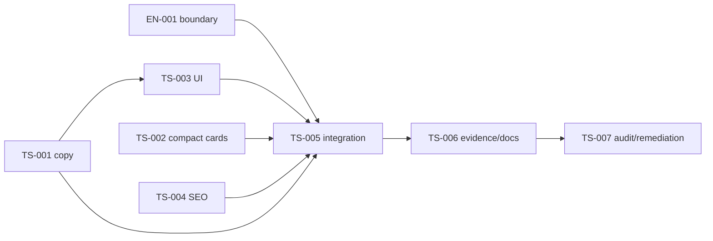

# Задачи и зависимости

Все EN-001/TS-001…TS-007 completed 2026-11-03 в automated/source scope; фактические evidence находятся в задачах и verification. [Правила](../../../../../standards/shared/delivery-rules.md), [минимальная проверка](../../../../../standards/shared/testing-rules.md).

| ID                                         | Ответственность                                           | Depends on                             | Тип     |
| ------------------------------------------ | --------------------------------------------------------- | -------------------------------------- | ------- |
| [EN-001](EN-001-catalog-boundary.md)       | Разрешённый content → catalog flow                        | —                                      | Enables |
| [TS-001](TS-001-wholesale-copy.md)         | Модель представления и полный copy UK/RU                  | —                                      | Enables |
| [TS-002](TS-002-compact-category-cards.md) | Компактный вариант существующих карточек каталога         | —                                      | Covers  |
| [TS-003](TS-003-wholesale-ui.md)           | Серверные UI-блоки принятого дизайна                      | TS-001                                 | Covers  |
| [TS-004](TS-004-wholesale-seo.md)          | Локализованные metadata и BreadcrumbList                  | —                                      | Covers  |
| [TS-005](TS-005-wholesale-integration.md)  | Серверная composition, route и sitemap                    | EN-001, TS-001, TS-002, TS-003, TS-004 | Covers  |
| [TS-006](TS-006-verification-handoff.md)   | Финальная согласованность, evidence и документация        | TS-005                                 | Covers  |
| [TS-007](TS-007-audit-remediation.md)      | Архитектурный аудит, локальные исправления и verification | TS-006                                 | Enables |

Независимы EN-001, TS-002 и TS-004; TS-003 следует за TS-001. TS-005 имеет одного интегратора, который сохраняет предыдущие изменения. После документационного этапа пользователь разрешил реализацию всей СДД; независимые UI/catalog/SEO пакеты реализованы агентами, root выполнил EN/integration/docs. При последующей реализации учитывать явное поручение пользователя о мультиагентной работе и не запускать вложенный Codex.

## Проверки по рискам

- Boundary EN-001: fixtures и graph, потому изменяется разрешённый flow.
- TS-002: один focused catalog-ui spec, включая default regression.
- TS-003: focused content-ui wholesale spec, две локали и slot/fallback.
- TS-004: focused content-seo wholesale specs.
- TS-005: focused content-feature wholesale/sitemap specs; site:typecheck для нового route/types; architecture:boundaries для фактических новых edges после imports (отдельный от EN-001 baseline риск).
- TS-006: использовать уже полученные evidence; повторять только затронутые финальной правкой проверки.
- TS-007: явный запрос аудита; scoped lint, свежие inferred inputs, четыре spec typechecks, cards regression и boundary/source checks. [Findings и результаты](../code-audit/audit.md).

Точные команды в задачах — не обязательный batch и не разрешение запускать build/browser/HTTP. Catalog model/data-access/core tests не повторяются без изменения их кода. Полные suites/coverage/build/E2E и полный аудит — только по отдельному явному запросу. Документационные ссылки/формат/diff проверены после актуализации результатов.
