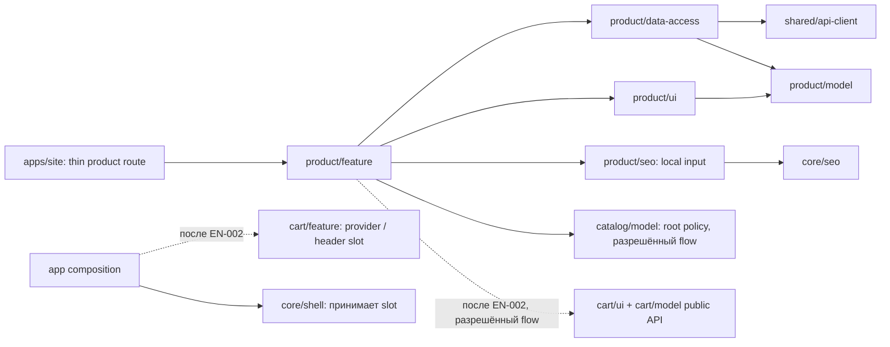

# Frontend: архитектура и карта реализации

## Проверенный базис на старте

Источники: [Site modules](../../../../../architecture/site/structure/modules.md), [delivery rules](../../../../../standards/shared/delivery-rules.md), [testing rules](../../../../../standards/shared/testing-rules.md), [boundary validator](../../../../../../tools/architecture/project-boundary-rules.mjs), [tsconfig aliases](../../../../../../tsconfig.base.json). Это локальная сверка непосредственных зависимостей, не полный аудит репозитория.

| Область             | Факт / решение                                                                                                                                                                           |
| ------------------- | ---------------------------------------------------------------------------------------------------------------------------------------------------------------------------------------- |
| Стек                | lockfile Next 16.4.3, React 19.3.0; `@nx/react` 24.0.3, Vitest 5.0.5. Источник — package-lock/package.json, не старое описание Vitest в стандарте                                        |
| Текущие проекты     | `site`, `site-shared-api-client`, `site-core-{config,i18n,seo,shell}`, пять `site-catalog-*`; product libraries созданы EN-001; cart libraries ещё нет                                   |
| Теги                | `scope:site`, `domain:product`; model/ui/data-access/feature по слою; **seo — `type:util`**, как существующий catalog SEO                                                                |
| Public API          | только `@site/product/<layer>` → `src/index.ts`; generated DTO только в data-access                                                                                                      |
| Данные              | server-only typed GET, Cache Components; client leaves получают нормализованные props, не импортируют транспорт                                                                          |
| Междоменные импорты | только feature и только documented flow; feature→feature запрещён, core не зависит от product/cart                                                                                       |
| UI                  | текущие shadcn/Radix primitives, Tailwind v4, Onest/JetBrains Mono, Lucide; новые пакеты не требуются                                                                                    |
| Тесты               | существующие библиотеки: `vite.config.mts`, jsdom, `vite:test`/typecheck inference. Новые точные targets подтверждаются EN-001 через `nx show project`, не объявляются уже существующими |

Подтверждённых системных нарушений затронутого исходного кода не выявлено. Отсутствие запланированных product/cart libraries — предпосылки EN-001/EN-002, не фиктивные `AF-*`. Если проверка конфигурации при EN-001 обнаружит нарушение, создать конкретный AF и устранить prerequisite до зависимой задачи. Старое упоминание `libs/site/catalog/ui` в качестве места страницы не заменяет предусмотренный архитектурой отдельный product domain.

## Целевые связи

Product UI не импортирует catalog UI из другого домена ради небольшого `ProductPhoto`. Поведение фото повторяется локально с теми же правилами CDN/fallback; извлечение общего media primitive допустимо только при реальной повторной общей ответственности и не является скрытым рефакторингом каталога.

Product feature использует только публичную catalog model policy скрытых корней и category destinations. EN-001 явно регистрирует `site-product-feature->site-catalog-model`; product mapper нормализует исходные breadcrumbs, feature фильтрует общий видимый trail. IDs корней не копируются в новый домен.

SEO принимает собственный input от feature и не импортирует model. Существующий `catalog/model` helper `productPath` и карточки сохраняются: маршрут уже соответствует целевому `/product/{slug}`. Каталог не начинает зависеть от product UI/model. Контроль одинакового route contract — focused тест ссылки/маршрута, а не feature-to-feature import.

## Планируемая карта файлов

Карта сверена с реализацией4A. Строки exists реализованы; cart adapter/quantity control остаются planned до EN-002. Имена тестов задают планируемые проверки рядом с владельцем.

| Путь                                                                                               | Состояние                 | Одна ответственность                                                                 |
| -------------------------------------------------------------------------------------------------- | ------------------------- | ------------------------------------------------------------------------------------ |
| `libs/site/product/{model,data-access,ui,seo,feature}/{project.json,vite.config.mts,src/index.ts}` | exists EN-001             | generated boundaries, public APIs и focused targets                                  |
| `model/src/lib/entities/product-details.ts`                                                        | exists                    | mapped product/media types                                                           |
| `model/src/lib/results/product-result.ts`                                                          | exists                    | доменные результаты чтения                                                           |
| `model/src/lib/purchase/purchase-policy.ts` + `.spec.ts`                                           | exists TS-001             | derived action mode и положительное количество                                       |
| `model/src/lib/paths/product-paths.ts` + `.spec.ts`                                                | exists TS-001             | canonical product path без генерации slug; category path остаётся catalog model      |
| `data-access/src/lib/contracts/{product.dto.ts,product-redirect.parser.ts}`                        | exists TS-002, AF-002     | private generated projections и unknown redirect-body parser                         |
| `data-access/src/lib/mappers/product-details.mapper.ts` + `.spec.ts`                               | exists TS-002             | DTO → model, independent price/stock/media normalization                             |
| `data-access/src/lib/loaders/product-details-loader.ts` + `.spec.ts`                               | exists TS-002             | cached lookup и mapping HTTP outcomes                                                |
| `data-access/src/lib/cache-tags.ts`                                                                | exists TS-002             | product tags и failure lifetime                                                      |
| `data-access/src/lib/crawling/product-index-loader.ts` + `.spec.ts`                                | exists TS-008             | bounded paged public listing snapshot для sitemap/seed                               |
| `ui/src/lib/gallery/product-gallery.tsx` + `.spec.tsx`                                             | exists TS-003             | выбор media, локальные отказы, zoom                                                  |
| `ui/src/lib/gallery/product-media.tsx`                                                             | exists TS-003             | реальный image и fallback одного URL                                                 |
| `ui/src/lib/detail/product-detail-view.tsx`                                                        | exists TS-004             | серверная раскладка первого экрана и секций                                          |
| `ui/src/lib/identity/product-identity.tsx`                                                         | exists TS-004             | H1, SKU, category, наличие                                                           |
| `ui/src/lib/identity/sku-copy-button.tsx` + `.spec.tsx`                                            | exists TS-004             | clipboard leaf с честным результатом                                                 |
| `ui/src/lib/purchase/product-purchase-panel.tsx` + `.spec.tsx`                                     | exists TS-004             | server price/pack и action slot/contact mode                                         |
| `ui/src/lib/purchase/product-quantity-control.tsx`                                                 | planned TS-005            | quantity leaf по cart policy                                                         |
| `ui/src/lib/details/product-facts.tsx`                                                             | exists TS-004             | таблица только доступных фактов                                                      |
| `ui/src/lib/service/product-service-links.tsx`                                                     | exists TS-004             | условия, опт, помощь, реальные destinations                                          |
| `ui/src/lib/i18n/{product-dictionary.ts,locales/uk.ts,locales/ru.ts}`                              | exists TS-004             | типизированный UI copy                                                               |
| `seo/src/lib/inputs/product-seo-input.ts`                                                          | exists TS-006             | собственный SEO input без импорта model                                              |
| `seo/src/lib/metadata/product-metadata.ts` + `.spec.ts`                                            | exists TS-006             | metadata, confirmed alternates, OG                                                   |
| `seo/src/lib/json-ld/{product-json-ld,product-breadcrumb-json-ld}.ts` + `.spec.ts`                 | exists TS-006             | правдивые Product/Offer/BreadcrumbList                                               |
| `feature/src/lib/detail/product-page.tsx` + `.spec.tsx`                                            | exists TS-007             | загрузка, HTTP outcome, server composition                                           |
| `feature/src/lib/detail/product-crumbs.ts`                                                         | exists TS-007             | один видимый breadcrumb trail для UI и SEO                                           |
| `feature/src/lib/mapping/product-category-href.ts` + `.spec.ts`                                    | exists TS-004/007, AF-001 | catalog categoryPath → localized ready categoryHref; UI не конструирует route policy |
| `feature/src/lib/mapping/product-seo-input.ts`                                                     | exists TS-006             | model → SEO input                                                                    |
| `feature/src/lib/routing/product-routing.ts` + `.spec.ts`                                          | exists TS-007             | metadata/static params/current locale route resolution                               |
| `feature/src/lib/purchase/product-cart-boundary.tsx` + `.spec.tsx`                                 | planned TS-005            | adapter к готовому cart public API                                                   |
| `feature/src/lib/crawling/product-sitemap.ts` + `.spec.ts`                                         | exists TS-008             | localized entries, shards и sitemap URLs                                             |
| `apps/site/src/app/[locale]/product/[slug]/page.tsx`                                               | exists TS-007             | thin route: params и feature exports                                                 |
| `apps/site/src/app/product/sitemap.ts`                                                             | exists TS-008             | thin metadata route с generateSitemaps                                               |
| `apps/site/src/app/robots.ts`                                                                      | exists, changed TS-008    | app composition передаёт product sitemap URLs в core builder                         |
| `libs/site/core/seo/src/lib/crawling/robots-file.ts`, `crawling.spec.ts`                           | exists, changed TS-008    | optional sitemap URLs без импорта domain, прежние defaults                           |

В путях без `libs/site/product/` этот префикс подразумевается до app/core строк. Тесты для pure model/mapper/SEO — unit, loader/routing/cart boundary — focused integration, галерея/purchase/clipboard — component. Gallery, clipboard, quantity/cart adapter — client leaves; цена, наличие, факты, сервис и structured data — server.

## Существующие файлы и решение о разделении

`apps/site` route/robots остаются тонкими. Пагинация sitemap, DTO mapping, JSX карточки и JSON-LD не добавляются в эти файлы. `core/shell` не получает product/cart imports. `core/seo` получает только универсальный optional sitemap input; никаких продуктовых запросов внутри. Каталожные card/listing/mappers не расширяются до product-detail монолита. Общий cart меняет shell/provider отдельно под EN-002, только после согласованного API.

## Проверки и поставка

Работа по этапам: domain/data → галерея/представление → SEO/routing/crawling → интеграция покупки после EN-002 → docs. После каждого этапа локальная проверка ответственности затронутых файлов; финальная карта сравнивается с фактической. Полный аудит, suite, build и browser проверки автоматически не назначаются.

Точные команды и evidence находятся в task files. Один focused запуск по изменённому владельцу; дополнительные lint/typecheck/contract/boundary проверки только для отдельного риска. Новый междоменный cart flow и aliases требуют boundary check. На этапе подготовки этой SDD проверяются только документация, ссылки и diff.

## Фактическое уточнение карты4A

В data-access добавлены cohesive identity/media/index mappers, отдельный index page transport/walker и cache wrapper; в feature разделены response, language paths и routing, а crawling — entries, XML budget/shards и orchestration. В SEO выделены URL helpers. Все эти роли перечислены в [actual feature card](../../../../../features/site/product.md). ProductQuantityControl и product-cart-boundary не созданы до EN-002. Source/test/app type projection23 roots, focused ESLint и boundary check108 projects прошли; это не полный аудит.

## Архитектурный аудит реализации

После реализации4A по запросу пользователя выполнен [scoped audit](../code-audit/audit.md). AF-001 вынес category destination в feature, AF-002 выделил private contracts, AF-003 синхронизировал consumer projection. Решения split/keep, source evidence и свежие проверки записаны в отчёте; новых междоменных разрешений и зависимостей не добавлено.
