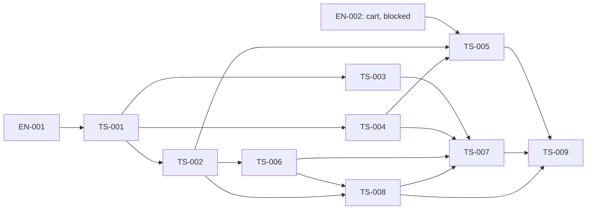

# Задачи и порядок

ID стабильны; номер не задаёт порядок исполнения. Independent read/UI/SEO ветка отделена от cart integration. Никакая запись в этом плане не является разрешением запускать build, browser, full suite или реализовывать cart foundation.

| ID                                              | Ответственность                                         | Depends on                         | Статус                                                    |
| ----------------------------------------------- | ------------------------------------------------------- | ---------------------------------- | --------------------------------------------------------- |
| [EN-001](enablers/EN-001-product-foundation.md) | product projects, public APIs, boundary flow            | —                                  | implemented, verified                                     |
| [EN-002](enablers/EN-002-cart-prerequisite.md)  | подтверждённый общий cart contract/foundation           | внешний шаг 5                      | blocked, внешний cart owner отсутствует                   |
| [TS-001](TS-001-model.md)                       | модель, пути и action/quantity policy                   | EN-001                             | implemented, unit verified                                |
| [TS-002](TS-002-data.md)                        | typed detail lookup и mapper                            | TS-001                             | implemented, mapper/loader verified                       |
| [TS-003](TS-003-gallery.md)                     | галерея и независимые media failures                    | TS-001                             | implemented, component/source verified                    |
| [TS-004](TS-004-detail-ui.md)                   | server detail UI, contact states, UK/RU                 | TS-001                             | implemented, server/contact/locale verified               |
| [TS-005](TS-005-cart-integration.md)            | quantity и реальная cart integration                    | EN-002, TS-002, TS-004             | blocked by EN-002                                         |
| [TS-006](TS-006-seo.md)                         | metadata/JSON-LD/alternate mapping                      | TS-002                             | implemented, 9 SEO tests pass                             |
| [TS-008](TS-008-crawling.md)                    | seed source, product sitemap/shards, robots composition | TS-002, TS-006                     | implemented, index/crawling/robots verified               |
| [TS-007](TS-007-routing.md)                     | route, HTTP resolution, page composition                | TS-003, TS-004, TS-006, TS-008     | implemented 4A; routing/SSR verified, live HTTP unrun     |
| [TS-009](TS-009-verification-docs.md)           | evidence, финальная структура и feature documentation   | все TS, EN-002 для полной поставки | 4A docs/evidence complete; full closure blocked by TS-005 |

[UI phase](03-react-web-ui.md) и [SEO phase](09-seo.md) — навигация, не замена task files. В каждом TS evidence заполняется фактическими Red/Green/refactor/regression результатами. Фактические результаты и пределы проверок записаны в task Evidence и verification/implementation.md; full cart delivery остаётся blocked.
